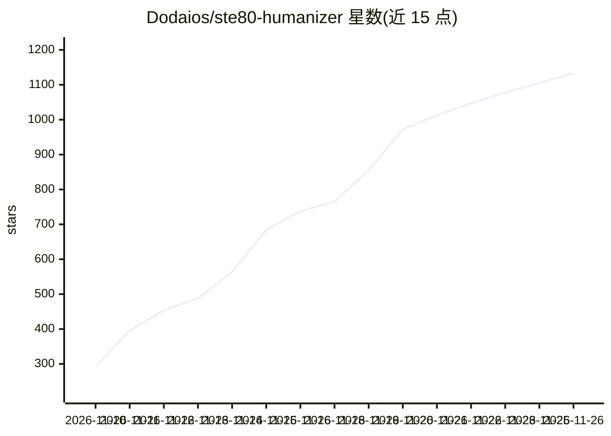

# Dodaios/ste80-humanizer

⭐ 1,133 · Python · MIT · 推送 2026-11-24 · [GitHub](https://github.com/Dodaios/ste80-humanizer) · [官网](https://skills.sh/Dodaios/ste80-humanizer) · 组织维护

**给 agent 用的去 AI 腔改写技能：按 ASD-STE100 简化英文重写文本**

以 SKILL.md 形式分发的 agent 技能，对 AI 生成的文本做两轮改写：第一轮移除 Wikipedia《Signs of AI writing》目录中的 26 种 AI 痕迹；第二轮按 Karpathy 提出的 ASD-STE100「80% 简化英文」方法重构句子（每句一个主意、主动语态、短句等 15 条规则）。提供 Humanize/Light/Strict 三种模式，支持匹配用户文风、保留事实并报告所触发的规则编号。通过 skills.sh、Claude Code 插件或 ZIP 上传安装到 Claude.ai/Claude Desktop。明确声明目标不是绕过 AI 检测器。

## 筛选速览

| 维度 | 判定 | 备注 |
|---|---|---|
| AI 角色 | `ai-native` | 本体是模型或模型工具 |
| 许可风险 | `permissive` | MIT |
| 部署形态 | `library` | 以包/库形式分发 |
| 模型依赖 | — | README 未给出锁定关系 |
| 硬件要求 | — | 无带数字的原话,不猜 |
| 安装摩擦 | `low` | 无编译、无系统依赖或容器化 |
| 成熟度 | — | 结构信号不足 |

## 能力要点

- 两轮改写：26 条 AI 痕迹清单 + 15 条 STE80 结构规则
- Humanize/Light/Strict 三种模式，改写按规则编号报告
- 可附加用户写作样本以匹配文风，声明保留全部事实
- 支持 skills.sh、Claude Code 插件、Claude.ai/Desktop ZIP 上传三种安装途径

## 适用场景

- 让 AI 生成的技术文档读起来像人写的
- 把 runbook、说明文档转成 STE 简化英文
- 判断一封邮件是否带有 AI 痕迹而不做改写

## 场景标签

`AI 写作` · 领域:内容生成

## 证据(README 行号)

> L9: STE80 Humanizer makes AI-written text read like a careful person wrote it, without changing what it says. It combine
> L82: Once installed, the skill answers to `/ste80-humanizer`. It also starts by itself when you ask to humanize, simplif
> L87: npx skills add Dodaios/ste80-humanizer

## 星数曲线

2026-11-10 293 → 2026-11-26 1,133（+840）

---
*卡片 v1 · prompt 1.4 · 生成 2026-11-25 · 置信度 high · 依据 README sha `6cc206462e39` · [字段定义](../../DATASET.md)*
