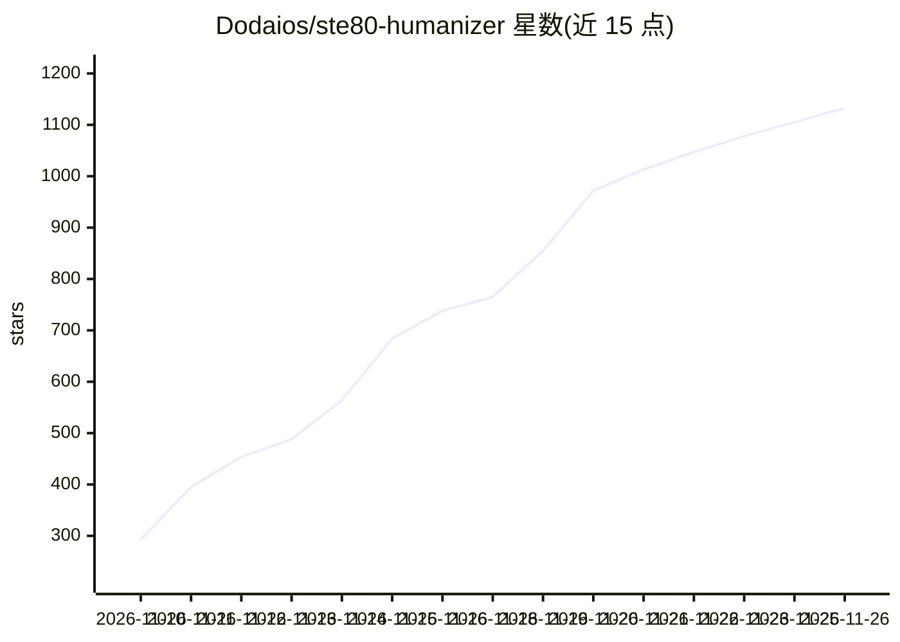

# Dodaios/ste80-humanizer

⭐ 1,133 · Python · MIT · 推送 2026-11-24 · [GitHub](https://github.com/Dodaios/ste80-humanizer) · [官网](https://skills.sh/Dodaios/ste80-humanizer) · 组织维护

**去除 AI 痕迹并按 STE80 规则改写文本的 agent 技能**

以 SKILL.md 形式分发的 agent 技能，对 AI 生成文本做两遍处理：第一遍依据 Wikipedia《Signs of AI writing》归纳的 26 条 AI 痕迹清单（去聊天开场白、破折号、堆叠限定词等）；第二遍按 Karpathy 提出的方法将句子重建为 ASD-STE100（航空维修用受控英语）的 80% 程度，即短句、每句一个意思、主动语态。提供 Humanize/Light/Strict 三种模式，支持用户文风样本匹配，并逐条编号报告改动。明确声明目标是可读性而非绕过 AI 检测器。安装后通过 /ste80-humanizer 命令调用，面向使用 Claude Code、Codex、Cursor 等 agent 的用户。

## 筛选速览

| 维度 | 判定 | 备注 |
|---|---|---|
| AI 角色 | `ai-native` | 本体是模型或模型工具 |
| 许可风险 | `permissive` | MIT |
| 部署形态 | `library` | 以包/库形式分发 |
| 模型依赖 | — | README 未给出锁定关系 |
| 硬件要求 | — | 无带数字的原话,不猜 |
| 安装摩擦 | `low` | 无编译、无系统依赖或容器化 |
| 成熟度 | — | 结构信号不足 |

## 能力要点

- 两遍处理：26 条 AI 痕迹清单 + 15 条 STE80 结构规则
- Humanize/Light/Strict 三种改写模式
- 保持事实不变，逐条编号（如 §1, §8, S2）报告改动
- 支持添加个人写作样本以匹配文风

## 适用场景

- 把 AI 生成的文档改写得更像人写的、更易读
- 将技术文档转换为 80% 或严格 ASD-STE100 风格
- 检查一段文字是否带 AI 痕迹而不做改写

## 场景标签

`AI 写作` · 领域:内容生成

## 证据(README 行号)

> L9: STE80 Humanizer makes AI-written text read like a careful person wrote it, without changing what it says. It combine
> L78: Both lists are compact tables with a short example. Pass 2 says what changes between **80%** and **Strict**. The fu
> L82: Once installed, the skill answers to `/ste80-humanizer`. It also starts by itself when you ask to humanize, simplif

## 星数曲线

2026-11-10 293 → 2026-11-26 1,133（+840）

---
*卡片 v1 · prompt 1.4 · 生成 2026-11-26 · 置信度 high · 依据 README sha `23aca20c885b` · [字段定义](../../DATASET.md)*
