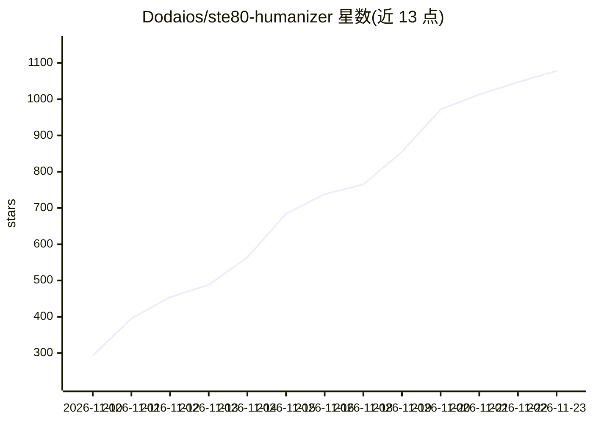

# Dodaios/ste80-humanizer

⭐ 1,078 · Python · MIT · 推送 2026-11-18 · [GitHub](https://github.com/Dodaios/ste80-humanizer) · [官网](https://skills.sh/Dodaios/ste80-humanizer) · 组织维护

**去除 AI 文风特征并按 STE80 重写文本的 agent 技能**

供 Claude Code、Codex、Cursor 等 agent 使用的技能（SKILL.md 格式），用于改写 AI 生成的文本：第一遍移除 Wikipedia 'Signs of AI writing' 目录中的 26 类特征，第二遍按 ASD-STE100 简化技术英语的 80% 松弛版本重建句子（短句、主动语态、一句一意）。提供 Humanize/Light/Strict 三档模式，编辑按编号报告，宣称保持事实不变。安装途径为 npx skills CLI、Claude Code 插件市场或手动上传 ZIP。

## 筛选速览

| 维度 | 判定 | 备注 |
|---|---|---|
| AI 角色 | `ai-native` | 本体是模型或模型工具 |
| 许可风险 | `permissive` | MIT |
| 部署形态 | `library` | 以包/库形式分发 |
| 模型依赖 | — | README 未给出锁定关系 |
| 硬件要求 | — | 无带数字的原话,不猜 |
| 安装摩擦 | `low` | 无编译、无系统依赖或容器化 |
| 成熟度 | — | 结构信号不足 |

## 能力要点

- 两遍方法：移除 26 类 AI 文风特征 + 15 条 STE80 结构规则
- Humanize/Light/Strict 三档模式，Strict 对应 100% ASD-STE100
- 编辑按编号（如 §1, S2）报告，可对照规则表查阅
- 支持匹配用户自带写作样本的句长与用词

## 适用场景

- 我想让 AI 写的 README 或文档读起来像人写的
- 把操作手册或安全说明转成严格简化技术英语
- 只轻微删掉文档里的 AI 腔，不改写整体结构

## 场景标签

`AI 写作` · 领域:内容生成

## 证据(README 行号)

> L7: STE80 Humanizer makes AI-written text read like a careful person wrote it, without changing what it says. It combine
> L9: 1. **The humanizer method.** Remove the 26 tells from Wikipedia's Signs of AI writing, in the catalog of blader/huma
> L10: 2. **Karpathy's STE80 method.** Rebuild the sentences "80% of the way to ASD-STE100", the controlled English of air

## 星数曲线

2026-11-10 293 → 2026-11-23 1,078（+785）

---
*卡片 v1 · prompt 1.4 · 生成 2026-11-17 · 置信度 high · 依据 README sha `215b3247f41a` · [字段定义](../../DATASET.md)*
