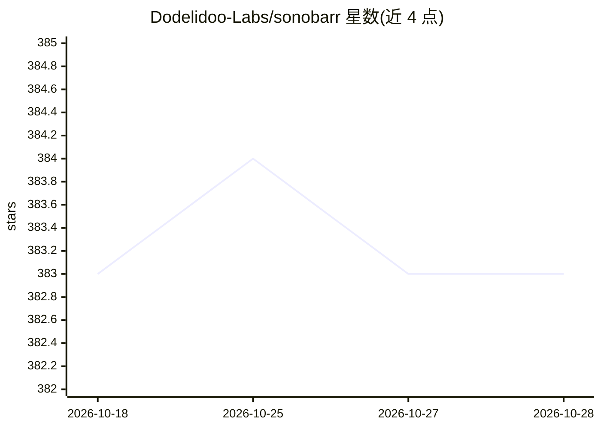

# Dodelidoo-Labs/sonobarr

⭐ 383 · Python · MIT · 推送 2026-09-09 · [GitHub](https://github.com/Dodelidoo-Labs/sonobarr) · 组织维护

**面向 Lidarr 用户的音乐发现自托管 Web 应用**

Flask + Socket.IO 自托管应用：读取 Lidarr 曲库中的艺人，调用 Last.fm 相似度接口流式返回推荐艺人卡片，支持 ListenBrainz 播放列表、YouTube/iTunes 试听预览，并可一键将选中的艺人添加回 Lidarr。提供基于角色的访问控制、OIDC 单点登录、艺术家请求审批工作流与 REST API。AI 部分为可选的 AI Assist 功能：用任意 OpenAI 兼容模型根据自然语言描述生成种子艺人并启动发现会话，未配置凭据时该功能停用，应用其余功能不受影响。以官方 GHCR Docker 镜像部署，配置经 .env 文件注入。

## 筛选速览

| 维度 | 判定 | 备注 |
|---|---|---|
| AI 角色 | `ai-enhanced` | 去掉 AI 部分产品仍成立 |
| 许可风险 | `permissive` | MIT |
| 部署形态 | `self-host` | docker 或自建部署 |
| 模型依赖 | local-ok | 支持本地模型 |
| 硬件要求 | — | 无带数字的原话,不猜 |
| 安装摩擦 | `low` | 无编译、无系统依赖或容器化 |
| 成熟度 | — | 结构信号不足 |

## 能力要点

- Lidarr 曲库 + Last.fm 相似度图流式推荐艺人并可一键回写 Lidarr
- 可选 AI Assist：任意 OpenAI 兼容模型按自然语言描述生成种子艺人
- 角色访问控制、OIDC SSO、艺术家请求审批与审计
- 官方 GHCR Docker 镜像，支持 PUID/PGID rootless 部署

## 适用场景

- 基于已有 Lidarr 曲库发现并收录相似新艺人
- 通过文字描述心情/风格让 AI 推荐种子艺人
- 多人共享一个实例，非管理员提请求、管理员审批

## 场景标签

`推荐系统` · 领域:学习与行业

## 证据(README 行号)

> L17: - 🤖 **AI assistant** - describe the vibe you want and let any OpenAI-compatible model seed new sessions with fresh 
> L161: - Provide an API key and/or base URL in the settings modal (.env works too) for whichever OpenAI-compatible provid

## 星数曲线

2026-10-18 383 → 2026-10-28 383（+0）

---
*卡片 v1 · prompt 1.4 · 生成 2026-10-21 · 置信度 high · 依据 README sha `3102d755b6cc` · [字段定义](../../DATASET.md)*
