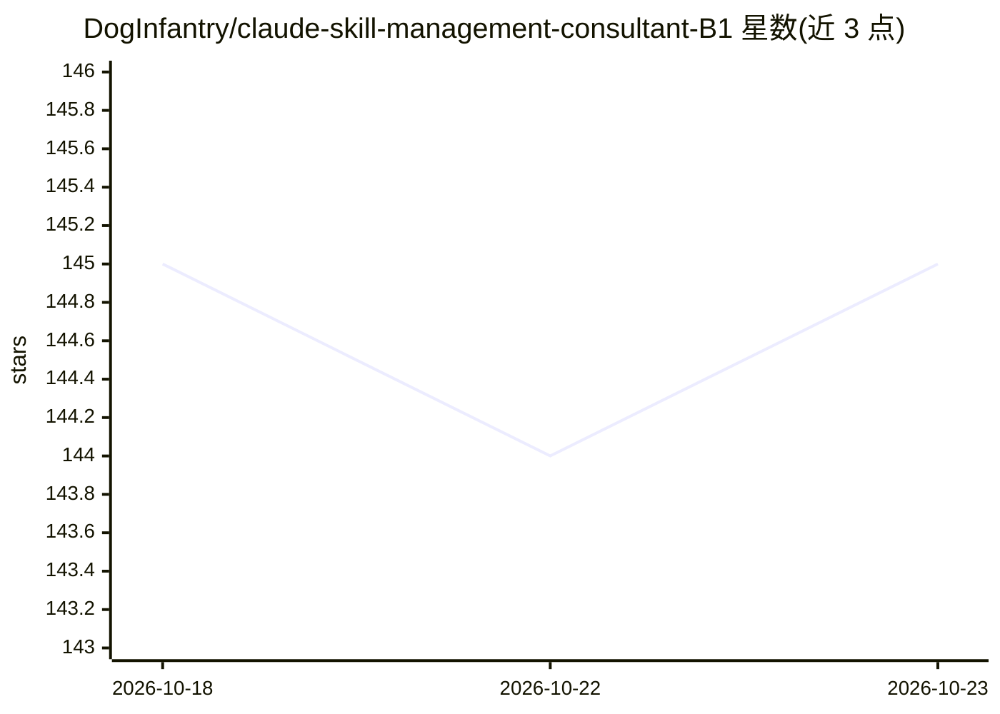

# DogInfantry/claude-skill-management-consultant-B1

⭐ 145 · HTML · NOASSERTION · 推送 2026-09-21 · [GitHub](https://github.com/DogInfantry/claude-skill-management-consultant-B1) · 个人维护

**给 AI 助手安装的管理咨询知识库技能（138 个参考模块）**

面向 MBA 学生、case interview 考生、商业人士与咨询从业者的结构化咨询知识系统：以 Claude Code 插件或手动复制 SKILL.md 方式安装到 AI 助手中，使其按 MBB 风格工作流（Frame→Structure→Analyse→Synthesise→Deliver）输出 MECE 问题树、金字塔原理沟通、咨询框架、行业参考与 case 面试练习。知识全部来自公开来源，不含任何咨询公司机密材料。除 Claude 外也兼容 Codex、Gemini、Copilot、Cursor、Ollama 等，通过各自配置文件自动加载。

## 筛选速览

| 维度 | 判定 | 备注 |
|---|---|---|
| AI 角色 | `ai-knowledge` | 知识聚合/清单类 |
| 许可风险 | `permissive` | NOASSERTION |
| 部署形态 | `None` |  |
| 模型依赖 | local-ok | 支持本地模型 |
| 硬件要求 | — | 无带数字的原话,不猜 |
| 安装摩擦 | `low` | 无编译、无系统依赖或容器化 |
| 成熟度 | — | 结构信号不足 |

## 能力要点

- 138 个参考模块，按 5 大知识支柱组织
- MECE 问题树、金字塔原理、假设驱动分析等方法体系
- 覆盖 Porter 五力、7-S、TAM/SAM/SOM 等全套咨询框架与 10+ 行业参考文件
- case interview 全流程练习（McKinsey/Bain/BCG 格式、评分与 PEI 准备）

## 适用场景

- 练习 case interview 并获得结构化反馈
- 让 AI 按咨询框架分析商业问题并产出董事会级交付物
- 咨询从业者加速搭建 issue tree 与 deck 结构

## 场景标签

`提示工程` · 领域:Agent 开发

## 证据(README 行号)

> L27: The **MBB Management Consultant AI Skill** is a structured knowledge system that installs into your AI assistant (C
> L62: This repository contains a consulting knowledge base for AI assistants: Claude, OpenAI Codex, Google Gemini, GitHub

## 星数曲线

2026-10-18 145 → 2026-10-23 145（+0）

---
*卡片 v1 · prompt 1.4 · 生成 2026-10-22 · 置信度 high · 依据 README sha `ac99d97baf6f` · [字段定义](../../DATASET.md)*
