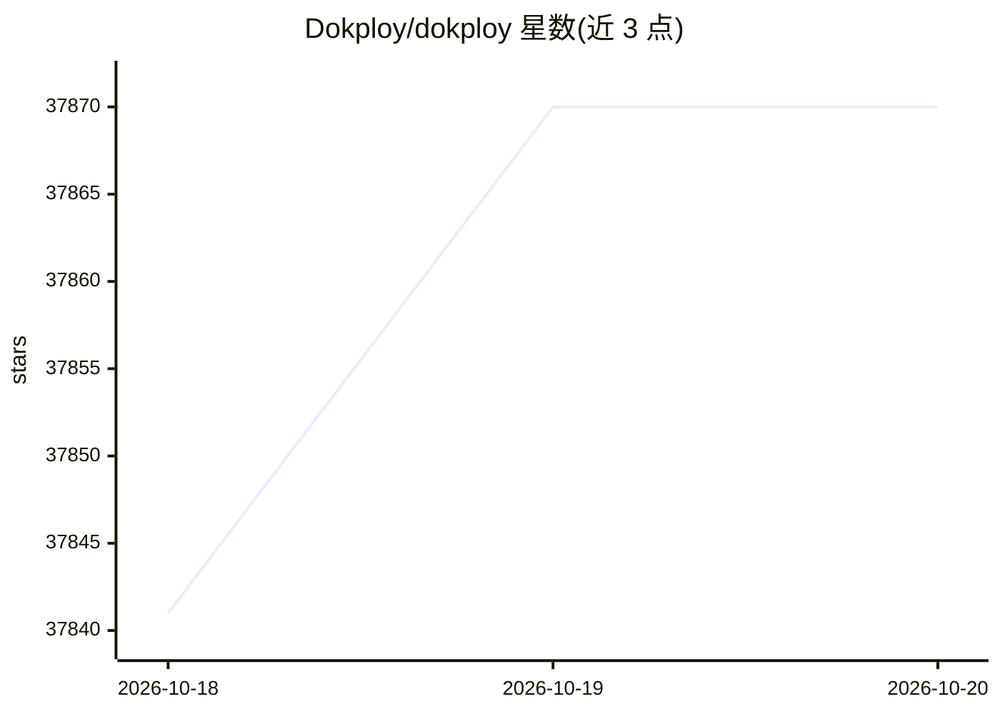

# Dokploy/dokploy

⭐ 37,870 · TypeScript · NOASSERTION · 推送 2026-10-16 · [GitHub](https://github.com/Dokploy/dokploy) · [官网](https://dokploy.com/) · 组织维护

**自托管 PaaS：部署和管理应用与数据库**

免费、可自托管的平台即服务（PaaS），用于简化应用与数据库的部署管理。支持部署多种语言应用（Node.js、PHP、Python、Go、Ruby 等）及 MySQL、PostgreSQL、MongoDB、MariaDB、Redis 等数据库；基于 Docker Swarm 实现多节点集群，内置 Traefik 路由集成、数据库外部备份、一键部署开源模板、实时资源监控与日志指标推送（Grafana、Datadog 等），并提供 CLI 与 API 管理入口。在 VPS 上通过一行脚本安装，另有 Dokploy Cloud 托管选项。

## 筛选速览

| 维度 | 判定 | 备注 |
|---|---|---|
| AI 角色 | `ai-ecosystem` | LLM/agent 周边工具 |
| 许可风险 | `none` | NOASSERTION |
| 部署形态 | `self-host` | docker 或自建部署 |
| 模型依赖 | — | README 未给出锁定关系 |
| 硬件要求 | — | 无带数字的原话,不猜 |
| 安装摩擦 | `low` | 无编译、无系统依赖或容器化 |
| 成熟度 | — | 结构信号不足 |

## 动量与使用信号

- 维护:`active` — 距上次 push 1.7 天,年发版 49,384 位贡献者
- 涨星:近 1 天 **+31**(自 20261016 起算)

## 能力要点

- 部署多语言应用与管理 6 种数据库
- Docker Swarm 多节点伸缩与 Traefik 自动集成
- 日志与指标推送至 Grafana、Datadog、AWS CloudWatch 等多个平台
- CLI 与 API 管理途径，支持多服务器远程部署

## 适用场景

- 在自有 VPS 上托管 Web 应用与数据库
- 为数据库配置到外部存储的自动备份
- 用 Docker Compose 管理复杂多容器应用
- 一键部署 Plausible、Pocketbase 等开源模板

## 场景标签

 · 领域:开发运维/部署平台

## 证据(README 行号)

> L2:  Dokploy - Open Source Alternative to Vercel, Heroku and Netlify.
> L10: Dokploy is a free, self-hostable Platform as a Service (PaaS) that simplifies the deployment and management of appl
> L20: - **Multi Node**: Scale applications to multiple nodes using Docker Swarm to manage the cluster.

## 星数曲线

2026-10-18 37,841 → 2026-10-20 37,870（+29）

---
*卡片 v1 · prompt 1.4 · 生成 2026-10-18 · 置信度 mid · 依据 README sha `620f2ba5126d` · [字段定义](../../DATASET.md)*
