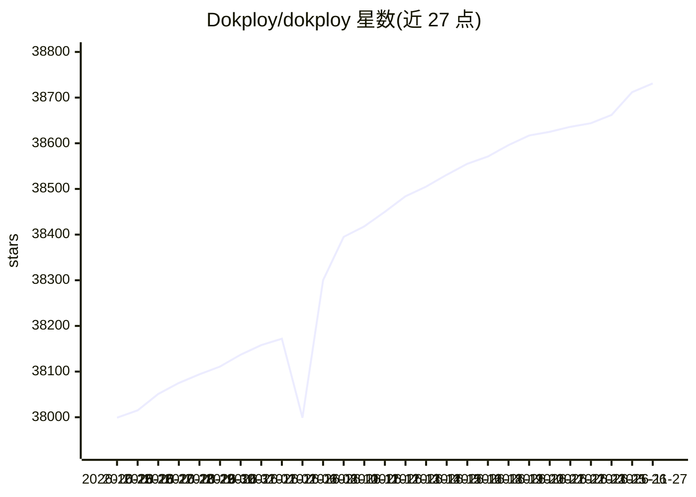

# Dokploy/dokploy

⭐ 38,731 · TypeScript · NOASSERTION · 推送 2026-11-26 · [GitHub](https://github.com/Dokploy/dokploy) · [官网](https://dokploy.com/) · 组织维护

**自托管 PaaS：部署和管理应用与数据库**

Dokploy 是可自托管的平台即服务（PaaS），用于简化应用与数据库的部署和管理。功能覆盖多语言应用部署（Node.js、PHP、Python、Go、Ruby 等）、多种数据库（MySQL、PostgreSQL、MongoDB、MariaDB、libsql、Redis）的创建管理、数据库自动备份到外部存储、Docker Compose 原生支持、基于 Docker Swarm 的多节点集群、600+ 一键部署模板、Traefik 路由集成、实时资源监控、日志与指标外发、CLI/API 管理、多服务器远程部署与部署通知。可在自有 VPS 上安装运行，另有 Dokploy Cloud 托管选项。

## 筛选速览

| 维度 | 判定 | 备注 |
|---|---|---|
| AI 角色 | `ai-enhanced` | 去掉 AI 部分产品仍成立 |
| 许可风险 | `none` | NOASSERTION |
| 部署形态 | `self-host` | docker 或自建部署 |
| 模型依赖 | — | README 未给出锁定关系 |
| 硬件要求 | — | 无带数字的原话,不猜 |
| 安装摩擦 | `low` | 无编译、无系统依赖或容器化 |
| 成熟度 | — | 结构信号不足 |

## 动量与使用信号

- 维护:`active` — 距上次 push 1.7 天,年发版 49,384 位贡献者
- 涨星:近 1 天 **+31**(自 20261016 起算)
- 下载:GitHub Release 附件 累计 792,855(100 个 release)

## 能力要点

- 支持部署多语言应用并管理 6 种数据库
- 基于 Docker Swarm 的多节点扩展与 Docker Compose 支持
- 600+ 开源模板一键部署
- 日志/指标外发至 Grafana、Datadog 等多种后端

## 适用场景

- 在自有 VPS 上自托管应用部署平台
- 一站式管理应用与数据库并自动备份
- 用 Docker Swarm 扩展应用到多节点集群

## 场景标签

 · 领域:DevOps/部署平台

## 证据(README 行号)

> L10: Dokploy is a free, self-hostable Platform as a Service (PaaS) that simplifies the deployment and management of appl
> L19: - **Docker Compose**: Native support for Docker Compose to manage complex applications.

## 星数曲线

2026-10-25 37,999 → 2026-11-27 38,731（+732）

---
*卡片 v1 · prompt 1.4 · 生成 2026-11-22 · 置信度 low · 依据 README sha `490dca324479` · [字段定义](../../DATASET.md)*
