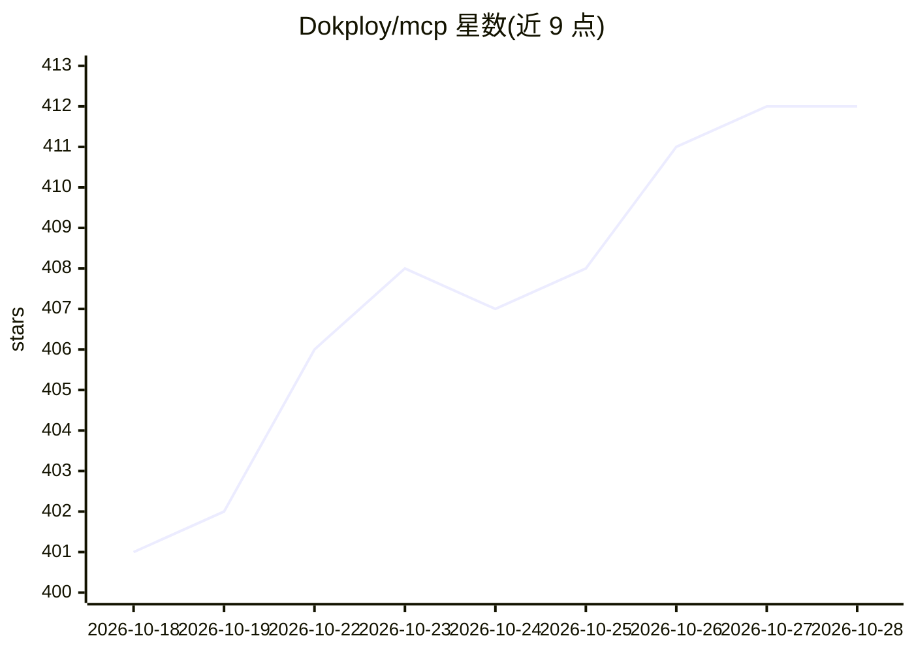

# Dokploy/mcp

⭐ 412 · TypeScript · NOASSERTION · 推送 2026-09-23 · [GitHub](https://github.com/Dokploy/mcp) · 组织维护

**将 Dokploy 全部 API 端点暴露为 MCP 工具的官方服务器**

Dokploy 官方维护的 MCP Server，把 Dokploy 部署平台的 API（508 个工具、49 类）封装为 Model Context Protocol 工具，供 Claude Desktop、Cursor、VS Code、Windsurf、Zed 等 MCP 客户端通过 AI 对话或程序化方式管理项目、应用、数据库（PostgreSQL/MySQL/MongoDB 等）、备份、SSO、通知与 Docker 集群。支持 stdio 与 HTTP/SSE 两种传输模式，可通过 npx、Bun、Deno 或 Docker 运行；提供工具集预设/标签过滤以适配大型工具列表，默认对响应中的密钥类字段做脱敏。

## 筛选速览

| 维度 | 判定 | 备注 |
|---|---|---|
| AI 角色 | `ai-ecosystem` | LLM/agent 周边工具 |
| 许可风险 | `none` | NOASSERTION |
| 部署形态 | `self-host` | docker 或自建部署 |
| 模型依赖 | — | README 未给出锁定关系 |
| 硬件要求 | — | 无带数字的原话,不猜 |
| 安装摩擦 | `low` | 无编译、无系统依赖或容器化 |
| 成熟度 | — | 结构信号不足 |

## 能力要点

- 508 个工具、49 类覆盖 Dokploy 全部 API 端点
- 支持 stdio、Streamable HTTP（MCP 2025-03-26）与旧版 SSE 三种传输
- 工具集预设（all/minimal/core/deploy 等）与标签过滤，适配大工具列表
- 默认脱敏 API 响应中的密钥/密码/token 字段（DOKPLOY_REDACT_ENV）

## 适用场景

- 在 Claude Desktop、Cursor 等 MCP 客户端中通过 AI 管理 Dokploy 部署平台
- 用 AI 对话执行应用部署、数据库生命周期与备份管理
- 以 HTTP 模式将 Dokploy 管理能力接入 Web 应用

## 场景标签

 · 领域:DevOps/部署平台工具

## 证据(README 行号)

> L5: Dokploy MCP Server exposes **all Dokploy API endpoints** as tools consumable via the Model Context Protocol (MCP). I
> L7: With **508 tools** across **49 categories**, this server provides complete coverage of the Dokploy API — from projec
> L268: ## Available Tools (508)

## 星数曲线

2026-10-18 401 → 2026-10-28 412（+11）

---
*卡片 v1 · prompt 1.4 · 生成 2026-10-21 · 置信度 high · 依据 README sha `fb970f3c53ed` · [字段定义](../../DATASET.md)*
