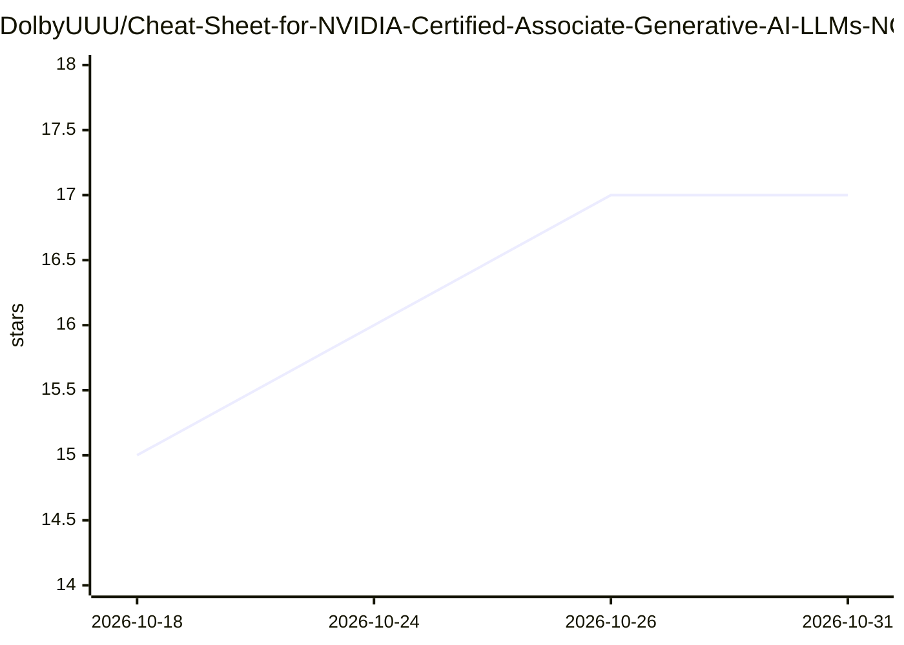

# DolbyUUU/Cheat-Sheet-for-NVIDIA-Certified-Associate-Generative-AI-LLMs-NCA-GENL-

⭐ 17 · 推送 2025-11-16 · [GitHub](https://github.com/DolbyUUU/Cheat-Sheet-for-NVIDIA-Certified-Associate-Generative-AI-LLMs-NCA-GENL-) · 个人维护 · 中文 README

**NVIDIA NCA-GENL 生成式 AI 认证考试备考速查表（中英双语）**

面向 NVIDIA Certified Associate - Generative AI LLMs (NCA-GENL) 认证考生的备考资料：以速查表与复习指南形式整理考试两大板块——基础 AI/ML/LLM 概念（提示工程、对齐技术、数据分析与实验设计等）与 NVIDIA 生成式 AI 全栈生态（软件、工具与服务）。README 说明题型为约 75% 单选题与约 25% 多选题，并附官方认证页面链接，提供英文与中文两个版本。

## 筛选速览

| 维度 | 判定 | 备注 |
|---|---|---|
| AI 角色 | `ai-knowledge` | 知识聚合/清单类 |
| 许可风险 | `none` | — |
| 部署形态 | `None` |  |
| 模型依赖 | — | README 未给出锁定关系 |
| 硬件要求 | — | 无带数字的原话,不猜 |
| 安装摩擦 | `medium` | 含编译或系统依赖之一 |
| 成熟度 | — | 结构信号不足 |

## 能力要点

- 覆盖 NCA-GENL 考试两大板块：基础 AI/ML/LLM 概念与 NVIDIA 生成式 AI 生态
- 说明题型构成（约 75% 单选、约 25% 多选）
- 提供英文与中文双语版本
- 附官方认证页面链接

## 适用场景

- 备考 NVIDIA NCA-GENL 认证时快速梳理考点
- 了解 NVIDIA 生成式 AI 生态各组件的分工
- 中英文读者按语言偏好复习考试内容

## 场景标签

`教程课程` · 领域:学习与行业

## 证据(README 行号)

> L3: This repository provides a concise cheat sheet and review guide for the **NVIDIA Certified Associate - Generative AI
> L5: The guide is available in both **English** and **Chinese**.

## 星数曲线

2026-10-18 15 → 2026-10-31 17（+2）

---
*卡片 v1 · prompt 1.4 · 生成 2026-10-30 · 置信度 high · 依据 README sha `7482a511cbcc` · [字段定义](../../DATASET.md)*
