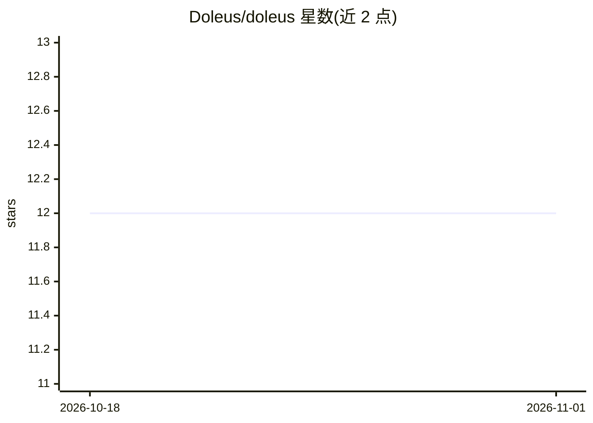

# Doleus/doleus

⭐ 12 · Python · Apache-2.0 · 推送 2025-12-16 · [GitHub](https://github.com/Doleus/doleus) · 组织维护

**面向图像 AI 模型的切片测试框架：量化子群体性能差距**

基于 PyTorch 的图像模型测试框架，面向目标检测与分类任务。用户为数据集添加元数据（自定义属性或预计算的亮度/对比度/分辨率等），按元数据切片（支持比较、成员、区间运算符及 AND/OR 组合条件），再在切片上运行 Check/CheckSuite 计算指标并做通过/失败断言，暴露聚合指标遗漏的性能差距。指标计算依赖 torchmetrics，分类指标默认 macro 平均以规避 torchmetrics micro 平均的已知缺陷（GitHub issue #2280）。以 pip 包提供，另提供 CPU-only PyTorch 轻量安装路径与分类演示脚本。

## 筛选速览

| 维度 | 判定 | 备注 |
|---|---|---|
| AI 角色 | `ai-ecosystem` | LLM/agent 周边工具 |
| 许可风险 | `permissive` | Apache-2.0 |
| 部署形态 | `library` | 以包/库形式分发 |
| 模型依赖 | — | README 未给出锁定关系 |
| 硬件要求 | — | 无带数字的原话,不猜 |
| 安装摩擦 | `medium` | 含编译或系统依赖之一 |
| 成熟度 | — | 结构信号不足 |

## 能力要点

- 按元数据切片（自定义+预计算属性），支持比较/成员/区间运算符与 AND/OR 组合
- Check/CheckSuite 在切片上计算指标并做通过/失败断言，可导出 JSON 报告
- 支持同一数据集挂载多个模型版本预测做对比测试
- 覆盖分类与目标检测任务，指标基于 torchmetrics（分类默认 macro 平均）

## 适用场景

- 医疗影像模型按患者分组核验各子群体敏感性
- 自动驾驶检测模型按天气/能见度条件测试性能差距
- 制造业质检模型按材料与缺陷尺寸切片验证召回/精度

## 场景标签

`模型评测` · 领域:评测与运维

## 证据(README 行号)

> L12: Doleus is a PyTorch-based testing framework for image-based AI models. It helps you understand how your models perf
> L258: - **Pass/fail tests**: `Check("test_name", slice, "model_id", "Accuracy", ">", 0.9)`

## 星数曲线

2026-10-18 12 → 2026-11-01 12（+0）

---
*卡片 v1 · prompt 1.4 · 生成 2026-11-01 · 置信度 high · 依据 README sha `41013cc9da2e` · [字段定义](../../DATASET.md)*
