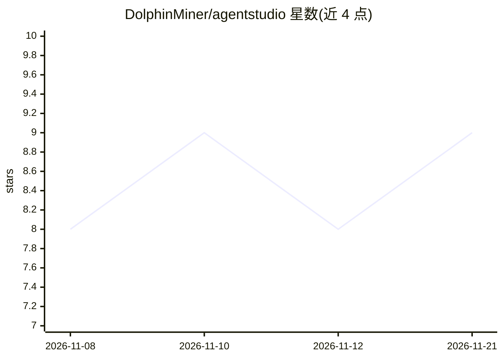

# DolphinMiner/agentstudio

⭐ 9 · TypeScript · Apache-2.0 · 推送 2026-11-04 · [GitHub](https://github.com/DolphinMiner/agentstudio) · 个人维护

**本地优先的 Mac 收件箱：人与多个 AI 代理统一对话与审批**

一个开源的 macOS 桌面应用（Electron），把个人聊天与 AI 代理放入同一收件箱：代理以联系人形式出现，需要决策时发送审批卡片，也可把会话连同上下文转给代理并取回回复草稿。通过自有账号登录接入 Grok Bot、Muse、ChatGPT Dots、Cue，并支持 AgentStudio Agent Protocol、A2A、ACP 协议的代理。底层用 Matrix/Synapse，本地栈以原生进程运行（无 Docker），所有状态留在本机。仅限个人学习研究使用，Alpha 阶段，从源码运行。

## 筛选速览

| 维度 | 判定 | 备注 |
|---|---|---|
| AI 角色 | `ai-ecosystem` | LLM/agent 周边工具 |
| 许可风险 | `permissive` | Apache-2.0 |
| 部署形态 | `library` | 以包/库形式分发 |
| 模型依赖 | — | README 未给出锁定关系 |
| 硬件要求 | — | 无带数字的原话,不猜 |
| 安装摩擦 | `low` | 无编译、无系统依赖或容器化 |
| 成熟度 | `idea` | |

## 能力要点

- 聊天与代理同一收件箱，代理请求以审批卡片决定
- 转发会话给代理并取回可编辑的回复草稿
- 支持 A2A、ACP 与自有开放协议接入代理
- 全部本地运行，登录凭证以系统 keychain 加密保存

## 适用场景

- 在同一收件箱中与多个个人 AI 代理对话
- 代理执行操作前逐一人工审批
- 把一段聊天上下文交给代理起草回复

## 场景标签

`AI 助手` `聊天机器人` · 领域:对话与助手

## 证据(README 行号)

> L12: An open-source inbox for your chats and your AI agents. Agents show up as contacts next to the people you talk to. 
> L27: - **Agents you already use**, through your own sign-in on the Mac: Grok Bot (every bot of your account, with its ow
> L28: - **Agents that speak an open protocol**: the AgentStudio Agent Protocol, A2A, and ACP. Hermes Agent and OpenClaw a

## 星数曲线

2026-11-08 8 → 2026-11-21 9（+1）

---
*卡片 v1 · prompt 1.4 · 生成 2026-11-20 · 置信度 mid · 依据 README sha `457d8f906582` · [字段定义](../../DATASET.md)*
