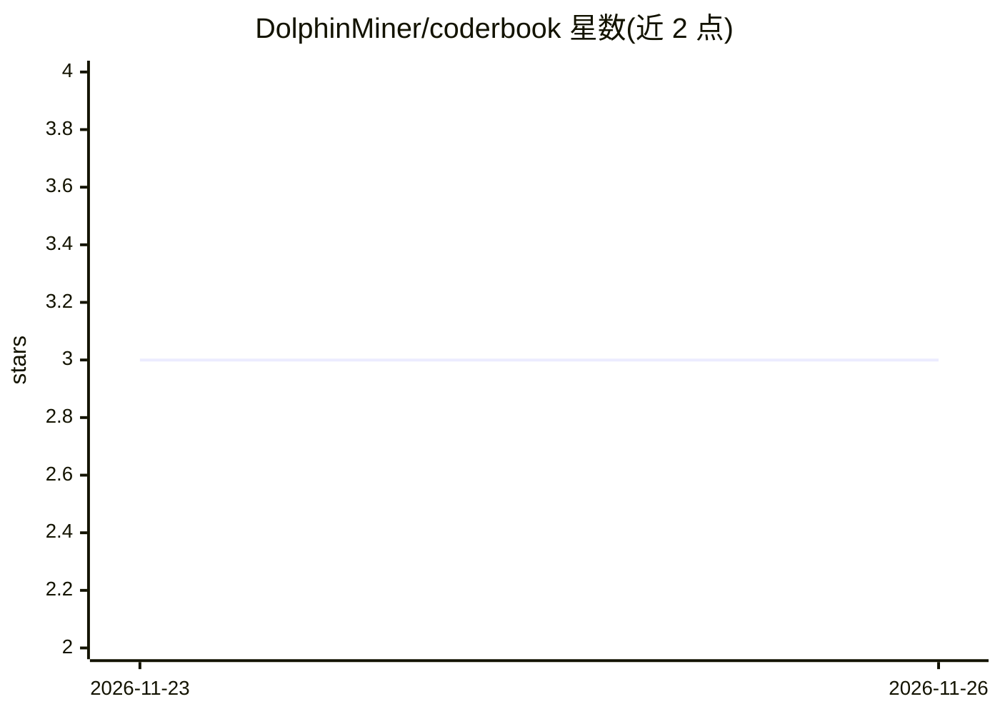

# DolphinMiner/coderbook

⭐ 3 · MIT · 推送 2026-10-16 · [GitHub](https://github.com/DolphinMiner/coderbook) · 个人维护 · 中文 README

**给程序员编码 agent 用的工程协作规范手册（技能）**

Coderbook 是一套面向编码 agent 的工程规范技能：将功能讨论、实现、提交、PR、代码评审、测试与验收的工作约定打包为 SKILL.md，供 Codex 等技能运行时加载后按规则执行，包括原子提交、每次提交后由两个不同 agent 评审、E2E 验证、按交付修订版验收等。仓库提供英文/中文双语 README，技能原始指令以中文为主。安装方式为 skill-installer 提示词或手动 git clone 后复制技能目录，另依赖两个上游伴侣技能（karpathy-guidelines、ponytail）。

## 筛选速览

| 维度 | 判定 | 备注 |
|---|---|---|
| AI 角色 | `ai-knowledge` | 知识聚合/清单类 |
| 许可风险 | `permissive` | MIT |
| 部署形态 | `None` |  |
| 模型依赖 | — | README 未给出锁定关系 |
| 硬件要求 | — | 无带数字的原话,不猜 |
| 安装摩擦 | `low` | 无编译、无系统依赖或容器化 |
| 成熟度 | — | 结构信号不足 |

## 能力要点

- 以 SKILL.md 技能形式提供工程协作规范，$coderbook 提及即可调用
- 约定含原子提交、每次提交后双 agent 评审、E2E 验证与验收
- 配套 coding-architecture-diagrams 图表技能，并依赖两个上游伴侣技能
- 英文/中文双语 README，技能原始指令以中文为主

## 适用场景

- 让编码 agent 按统一规范完成功能开发、修复与重构
- 团队为 agent 协助的提交与代码评审建立共享约定
- 让 agent 对当前分支改动按规范执行代码评审

## 场景标签

`编码 Agent` `代码审查` · 领域:编码与开发

## 证据(README 行号)

> L5: **An engineering handbook for coding agents.**
> L7: Coderbook brings together working conventions for feature discussions, implementation, commits, pull requests, code 
> L9: The existing conventions cover simple designs that address root causes, atomic commits, reviews by two different age

## 星数曲线

2026-11-23 3 → 2026-11-26 3（+0）

---
*卡片 v1 · prompt 1.4 · 生成 2026-11-23 · 置信度 high · 依据 README sha `e777350ed91f` · [字段定义](../../DATASET.md)*
