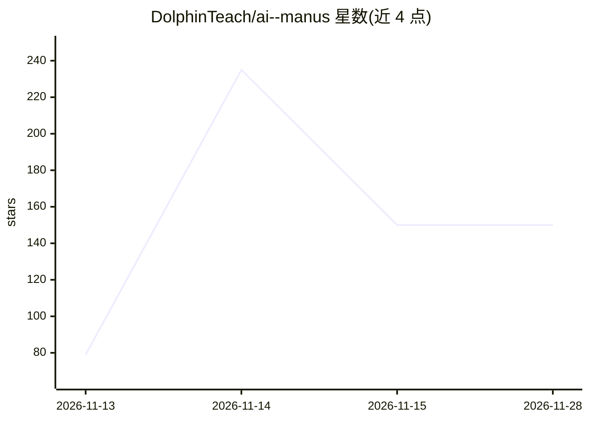

# DolphinTeach/ai--manus

⭐ 150 · Apache-2.0 · 推送 2026-11-15 · [GitHub](https://github.com/DolphinTeach/ai--manus) · 组织维护

**面向日常任务的自主 AI Agent：自动执行代码与浏览器操作**

README 描述 Manus 为可在沙盒环境中运行工具与操作的通用 AI Agent 系统：以自主方式编写并执行脚本、控制浏览器（导航页面、填写表单、采集信息），完成多步骤任务，定位为面向家庭、学习与轻量办公场景的个人助手，而非企业级平台。给出系统兼容性表（双核 CPU、4GB RAM 起步）与使用步骤说明，但未提供具体安装命令、模型接入方式或代码结构等技术细节，内容以功能介绍与关键词罗列为主，可验证的实现信息有限。

## 筛选速览

| 维度 | 判定 | 备注 |
|---|---|---|
| AI 角色 | `ai-native` | 本体是模型或模型工具 |
| 许可风险 | `permissive` | Apache-2.0 |
| 部署形态 | `None` |  |
| 模型依赖 | — | README 未给出锁定关系 |
| 硬件要求 | — | 无带数字的原话,不猜 |
| 安装摩擦 | `low` | 无编译、无系统依赖或容器化 |
| 成熟度 | — | 结构信号不足 |

## 能力要点

- 自主执行代码与脚本运行
- 浏览器控制：导航、填表、采集信息
- 代码与浏览器操作可在同一任务流中衔接
- 面向小型任务与多步骤日常自动化

## 适用场景

- 让学生整理研究资料、运行小脚本
- 让 agent 代为浏览网页、填写重复表单
- 远程办公中跨多个页面收集信息并汇总

## 场景标签

`AI 助手` `浏览器自动化` `编码 Agent` · 领域:效率与自动化

## 证据(README 行号)

> L10: - **Autonomous Code Execution:** Manus AI agent runs code on its own to complete tasks, so you can focus on decisio
> L18: Manus is an autonomous AI agent designed to run code and control a browser on your behalf. Instead of acting like a

## 星数曲线

2026-11-13 79 → 2026-11-28 150（+71）

---
*卡片 v1 · prompt 1.4 · 生成 2026-11-17 · 置信度 low · 依据 README sha `0f78ee3a5dd2` · [字段定义](../../DATASET.md)*
