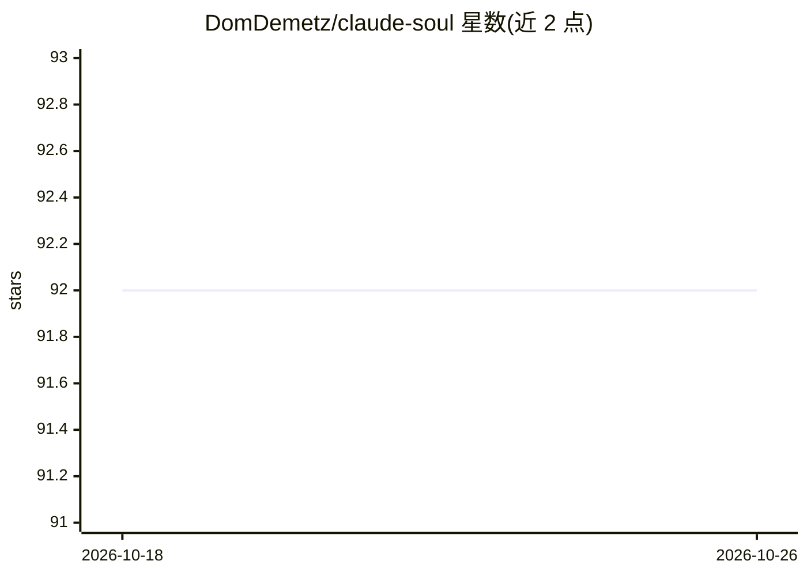

# DomDemetz/claude-soul

⭐ 92 · TypeScript · MIT · 推送 2026-05-29 · [GitHub](https://github.com/DomDemetz/claude-soul) · 个人维护

**Claude Code 的跨会话记忆与行为校正学习引擎**

面向 Claude Code（Pro/Max）用户的持久化学习扩展：通过官方扩展点（15 个工具的 MCP server 与 hooks）运行，提供跨会话记忆（本地 SQLite 存储，可选 Ollama 语义向量检索）、纠错模式追踪（自动检测用户纠正并分类行为模式，含 new→active→improving→internalized 生命周期）、以及周期性反思与行为框架演化。以 npx 命令安装，本地运行、无需 API key 与云服务；含 CLI 用于查看行为数据。

## 筛选速览

| 维度 | 判定 | 备注 |
|---|---|---|
| AI 角色 | `ai-ecosystem` | LLM/agent 周边工具 |
| 许可风险 | `permissive` | MIT |
| 部署形态 | `library` | 以包/库形式分发 |
| 模型依赖 | local-ok | 支持本地模型 |
| 硬件要求 | — | 无带数字的原话,不猜 |
| 安装摩擦 | `low` | 无编译、无系统依赖或容器化 |
| 成熟度 | — | 结构信号不足 |

## 能力要点

- 跨会话记忆：本地 SQLite + 可选 Ollama 语义检索
- 自动检测并分类用户纠正，追踪行为模式趋势
- 15 个 MCP 工具 + hooks，经 Claude Code 官方扩展点运行
- soul 文件体系（SOUL/SHADOW/STORY/CORRECTIONS 等）存储身份与行为数据

## 适用场景

- 让 Claude Code 记住跨会话的决策与教训，按语义检索
- 追踪我对 Claude 的反复纠正，观察行为是否改善
- 在长期使用中让助手形成持续演化的行为框架

## 场景标签

`Agent 记忆` · 领域:Agent 开发

## 证据(README 行号)

> L125: Everything runs through Claude Code's official extension points: an MCP server (15 tools) and hooks (signal extrac
> L15: **Prerequisites:** Node.js >= 18, Claude Code (Pro or Max plan).

## 星数曲线

2026-10-18 92 → 2026-10-26 92（+0）

---
*卡片 v1 · prompt 1.4 · 生成 2026-10-23 · 置信度 high · 依据 README sha `20d0aac82574` · [字段定义](../../DATASET.md)*
