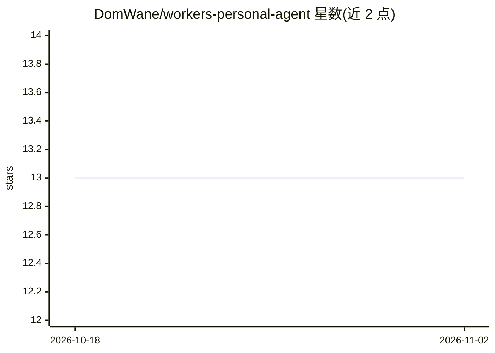

# DomWane/workers-personal-agent

⭐ 13 · TypeScript · MIT · 推送 2026-09-27 · [GitHub](https://github.com/DomWane/workers-personal-agent) · 个人维护

**运行在 Cloudflare Workers 免费层的个人 AI 对话代理，带记忆与深度研究**

部署在 Cloudflare Workers 上的个人 AI agent：每个会话一个 Durable Object，长期记忆以 markdown 存于 R2，基于 Durable Object SQLite 嵌入索引做语义召回；深度研究模式按角度扇出到子 Durable Object 并生成报告。模型默认走 Workers AI，也可改用任意 OpenAI 兼容端点（OpenRouter/OpenAI/Groq/本地 Ollama）。支持 MCP 服务器接入、自动压缩的历史、代理自写技能与定时任务。免费层各项限额（子请求数、Workers AI 神经元等）有实测表格，部署强制要求开启 Cloudflare Access。

## 筛选速览

| 维度 | 判定 | 备注 |
|---|---|---|
| AI 角色 | `ai-native` | 本体是模型或模型工具 |
| 许可风险 | `permissive` | MIT |
| 部署形态 | `library` | 以包/库形式分发 |
| 模型依赖 | local-ok | 支持本地模型 |
| 硬件要求 | — | 无带数字的原话,不猜 |
| 安装摩擦 | `low` | 无编译、无系统依赖或容器化 |
| 成熟度 | — | 结构信号不足 |

## 能力要点

- 每会话一个 Durable Object，记忆为 R2 markdown + SQLite 嵌入索引语义召回
- 深度研究模式按角度扇出子 Durable Object，各带 50 次子请求预算
- 支持 MCP 服务器（OAuth/bearer token）与任意 OpenAI 兼容 API 端点
- 免费层限额实测表格与配套 eval 套件（检索器对比、ThinkingCap 复现）

## 适用场景

- 在 Cloudflare 免费层自托管一个带长期记忆的个人聊天代理
- 发起扇出多角度调研并产出带来源的深度研究报告
- 接入自有 MCP 服务器扩展代理可调用的工具

## 场景标签

`AI 助手` `Agent 记忆` `科研工具` · 领域:Agent 开发

## 证据(README 行号)

> L5: A personal AI agent that runs entirely on Cloudflare's free tier. One Durable Object per
> L18: - **Deep research.** The agent proposes a plan first, then fans out one child Durable Object per
> L42: **Stack:** Cloudflare Workers, Agents SDK, Durable Objects, R2, Workers AI or any OpenAI-compatible

## 星数曲线

2026-10-18 13 → 2026-11-02 13（+0）

---
*卡片 v1 · prompt 1.4 · 生成 2026-11-01 · 置信度 high · 依据 README sha `44b7b9073280` · [字段定义](../../DATASET.md)*
