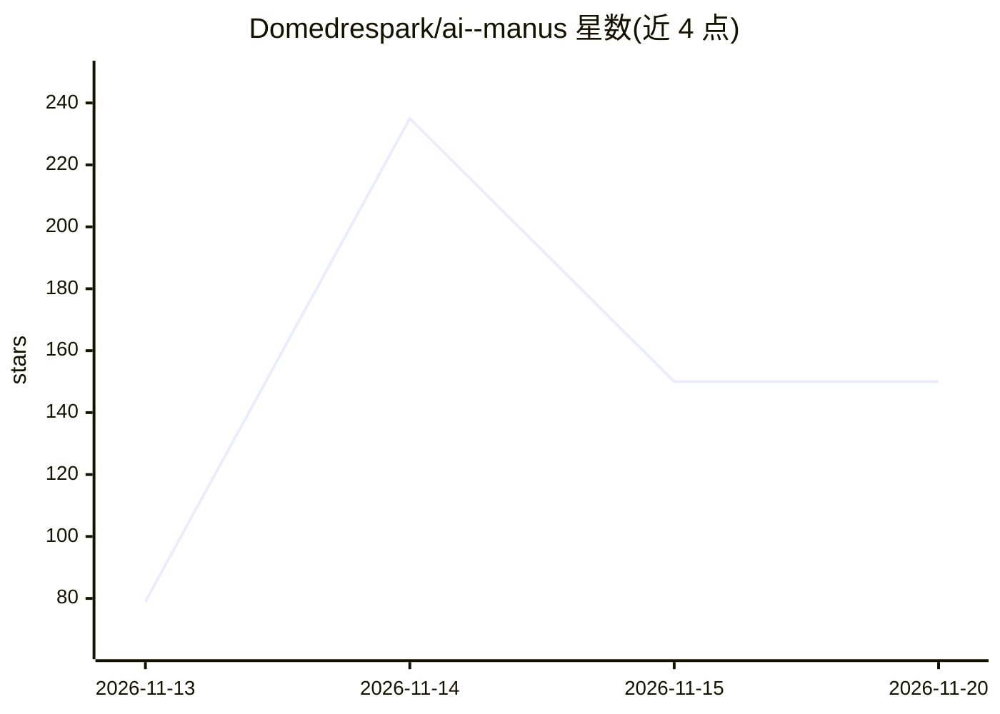

# Domedrespark/ai--manus

⭐ 150 · Apache-2.0 · 推送 2026-11-15 · [GitHub](https://github.com/Domedrespark/ai--manus) · 个人维护

**自主执行代码与浏览器操作的个人 AI Agent 助手**

Manus 是一个自主 AI Agent：接收用户指令后代为编写并执行脚本、打开网页、填写表单、完成多步骤任务，可跨代码与浏览器衔接工作流，在后台作为个人助手运行，面向学习、家庭项目与轻量办公场景的非开发者用户。README 提供最低/推荐硬件配置表（双核 CPU、4GB 内存等）与上手步骤（准备、配置、测试、逐步扩展），但未给出任何安装命令、下载链接或代码入口，仓库内容不可据此验证实际可用性。

## 筛选速览

| 维度 | 判定 | 备注 |
|---|---|---|
| AI 角色 | `ai-native` | 本体是模型或模型工具 |
| 许可风险 | `permissive` | Apache-2.0 |
| 部署形态 | `None` |  |
| 模型依赖 | — | README 未给出锁定关系 |
| 硬件要求 | — | 无带数字的原话,不猜 |
| 安装摩擦 | `low` | 无编译、无系统依赖或容器化 |
| 成熟度 | — | 结构信号不足 |

## 能力要点

- 自主编写并执行代码以完成任务
- 浏览器控制：导航网页、填表、采集信息
- 代码与浏览器动作在同一工作流中衔接
- README 给出最低/推荐硬件兼容表

## 适用场景

- 让 Agent 代为完成查网页、填表、整理文件等重复性小任务
- 学习中运行小脚本、组织研究笔记
- 轻量办公中跨多页面收集信息并汇总

## 场景标签

`AI 助手` `编码 Agent` `浏览器自动化` · 领域:效率与自动化

## 证据(README 行号)

> L10: - **Autonomous Code Execution:** Manus AI agent runs code on its own to complete tasks, so you can focus on decisio
> L18: Manus is an autonomous AI agent designed to run code and control a browser on your behalf. Instead of acting like a

## 星数曲线

2026-11-13 79 → 2026-11-20 150（+71）

---
*卡片 v1 · prompt 1.4 · 生成 2026-11-17 · 置信度 low · 依据 README sha `a3d88e202bf0` · [字段定义](../../DATASET.md)*
