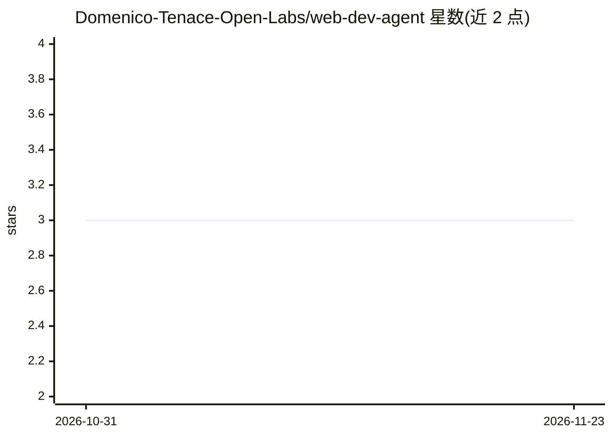

# Domenico-Tenace-Open-Labs/web-dev-agent

⭐ 3 · Python · MIT · 推送 2026-11-09 · [GitHub](https://github.com/Domenico-Tenace-Open-Labs/web-dev-agent) · 个人维护

**为前端开发者提供的 OpenCode 多智能体配置集**

一组 OpenCode 全局配置（agents、skills、slash commands、rules），部署到 ~/.config/opencode 即用，无构建步骤与应用运行时。包含 1 个主 agent（Astro/Vue/Nuxt/Vite/TypeScript 通用开发）与 6 个领域子 agent（代码审查、SEO、UI/UX、无障碍、文档、安全审计），每类各持一项技能。所有写操作与 shell 命令默认审批通过（effect: ask），工作区沙箱限制外部目录访问，clean-code 规则自动注入每个会话，框架规范按需以技能加载。要求安装 OpenCode 与 Python 3；/scaffold-frontend-project 命令仅支持 pnpm。

## 筛选速览

| 维度 | 判定 | 备注 |
|---|---|---|
| AI 角色 | `ai-ecosystem` | LLM/agent 周边工具 |
| 许可风险 | `permissive` | MIT |
| 部署形态 | `None` |  |
| 模型依赖 | — | README 未给出锁定关系 |
| 硬件要求 | — | 无带数字的原话,不猜 |
| 安装摩擦 | `low` | 无编译、无系统依赖或容器化 |
| 成熟度 | — | 结构信号不足 |

## 能力要点

- 7 个 agent 定义：1 个主 agent + 6 个领域专家子 agent
- 写/编辑与 shell 命令均需显式审批，危险命令（rm -rf、git push 等）被拒绝
- clean-code 规则经 opencode.jsonc 自动注入，框架技能按需加载
- 附 gh_grep 远程 MCP 服务器做 GitHub 代码搜索

## 适用场景

- 用 OpenCode 管理 Astro/Vue/Nuxt 前端项目的日常开发
- 对代码变更按严重程度分级审查并给出修复建议
- 审计页面的 SEO、无障碍（WCAG 2.2 AA）与安全问题
- 从零脚手架生成严格 TypeScript 的三页前端项目

## 场景标签

`多智能体` `编码 Agent` `代码审查` `代码生成` · 领域:Agent 开发

## 证据(README 行号)

> L5: Ready-to-use set of OpenCode agents, skills, slash commands and rules for modern frontend development, with a specia
> L7: This repository is an **OpenCode global configuration** (default location: `~/.config/opencode`), not a traditional 
> L90: - OpenCode, recent version

## 星数曲线

2026-10-31 3 → 2026-11-23 3（+0）

---
*卡片 v1 · prompt 1.4 · 生成 2026-11-22 · 置信度 high · 依据 README sha `e5208fa553a0` · [字段定义](../../DATASET.md)*
