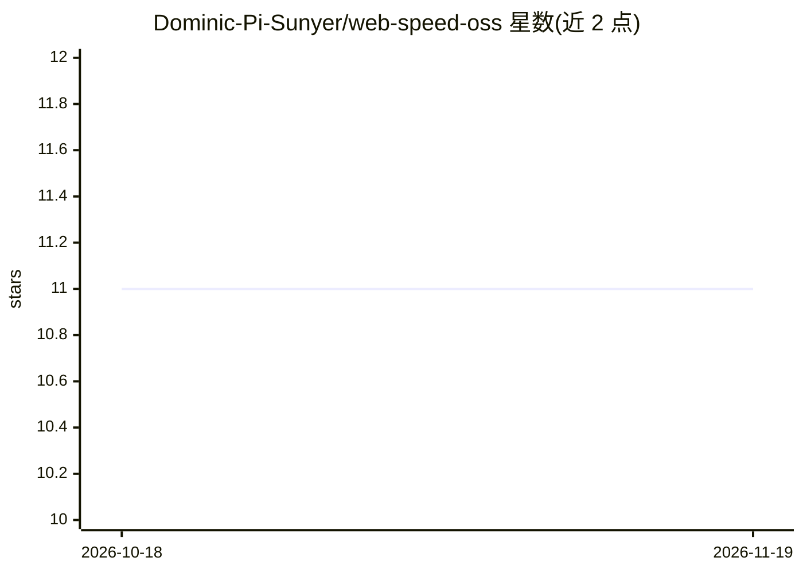

# Dominic-Pi-Sunyer/web-speed-oss

⭐ 11 · Python · GPL-3.0 · 推送 2026-10-26 · [GitHub](https://github.com/Dominic-Pi-Sunyer/web-speed-oss) · [官网](https://getwebspeed.io) · 个人维护

**为 AI agent 提供确定性网页结构地图的 MCP 工具服务器**

面向 agent 场景的 MCP 服务器（社区版），将面向人类的杂乱 HTML 转化为确定性的结构化 JSON 地图：提供 interpret_page、submit_form、site_map、inspect_element、page_type、invalidate_cache 六个工具，覆盖页面解析、表单提交、全站爬取、选择器钻取与页面分类，输出统一 schema 并最多削减约 97% 的 token。产品本身不含 LLM 依赖，解释工作由调用方 agent 完成。从源码以 Python venv 安装运行，支持注册到 Claude Desktop/Cowork；默认将页面结构数据异步同步到共享注册表，可关闭或指向自托管实例。已知限制包括 SPA 预渲染外壳、本地磁盘缓存与不限流。

## 筛选速览

| 维度 | 判定 | 备注 |
|---|---|---|
| AI 角色 | `ai-ecosystem` | LLM/agent 周边工具 |
| 许可风险 | `viral` | GPL-3.0 |
| 部署形态 | `library` | 以包/库形式分发 |
| 模型依赖 | — | README 未给出锁定关系 |
| 硬件要求 | — | 无带数字的原话,不猜 |
| 安装摩擦 | `low` | 无编译、无系统依赖或容器化 |
| 成熟度 | — | 结构信号不足 |

## 能力要点

- 六个 MCP 工具：页面解析、表单提交、全站爬取、选择器钻取、页面分类、缓存失效
- 确定性输出 schema，宣称最高 97% token 削减
- 无 LLM 依赖，结构默认 24h 本地磁盘缓存
- 默认向共享注册表同步页面结构数据，可 opt-out 或自托管

## 适用场景

- 让 agent 以更低 token 消耗读取和导航网站
- 让 agent 解析表单字段并携带 CSRF token 提交表单
- 爬取整站结构以预规划多步自动化工作流
- 本地开发服务器的结构化读取（需配置白名单）

## 场景标签

`浏览器自动化` `网页抓取` · 领域:效率与自动化

## 证据(README 行号)

> L3: Web Speed solves the **Signal-to-Noise problem** for AI agents. While the modern web is optimized for human eyes (me
> L5: **No AI inside.** No `anthropic`, no `openai`, no LLM dependency of any kind. All interpretation lives in the callin
> L63: ## Register with Claude / Cowork

## 星数曲线

2026-10-18 11 → 2026-11-19 11（+0）

---
*卡片 v1 · prompt 1.4 · 生成 2026-11-19 · 置信度 high · 依据 README sha `2c15de8983c6` · [字段定义](../../DATASET.md)*
