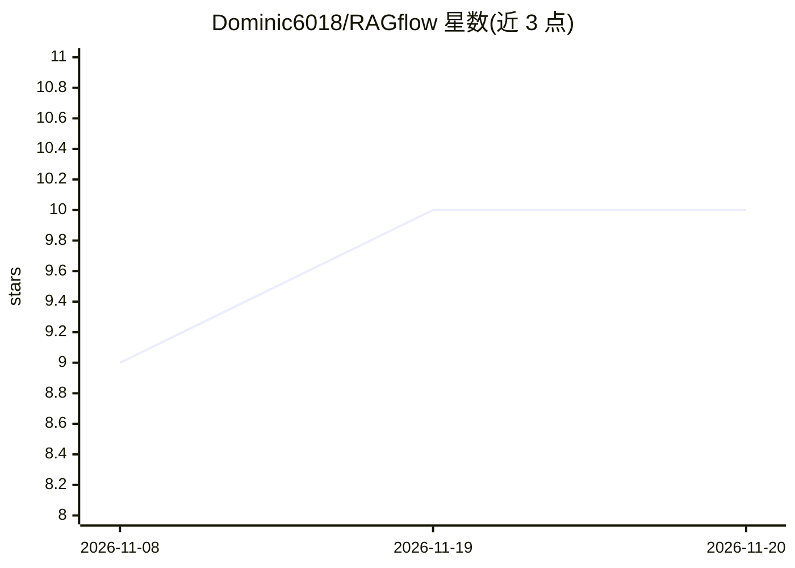

# Dominic6018/RAGflow

⭐ 10 · Go · Apache-2.0 · 推送 2026-11-15 · [GitHub](https://github.com/Dominic6018/RAGflow) · 组织维护 · 中文 README

**面向企业与开发者的深度文档理解 RAG 引擎**

开源检索增强生成（RAG）引擎，结合 Agent 能力为 LLM 提供上下文层。核心机制包括基于深度文档理解的模板化分块（支持文本分块可视化与人工干预）、文档与数据集级的知识编译（生成 Wiki/图谱/树/时间线等产物）、Low 至 Ultra 四档思考模式的多步检索，以及带可溯源引用的回答。支持 Word/PPT/Excel/PDF/网页等多种异构数据源，提供 Web UI 与 API。部署方式为 Docker 或源码启动，macOS 平台当前不受支持。

## 筛选速览

| 维度 | 判定 | 备注 |
|---|---|---|
| AI 角色 | `ai-native` | 本体是模型或模型工具 |
| 许可风险 | `permissive` | Apache-2.0 |
| 部署形态 | `self-host` | docker 或自建部署 |
| 模型依赖 | — | README 未给出锁定关系 |
| 硬件要求 | — | 无带数字的原话,不猜 |
| 安装摩擦 | `low` | 无编译、无系统依赖或容器化 |
| 成熟度 | — | 结构信号不足 |

## 能力要点

- 基于深度文档理解的模板化分块，支持可视化与人工干预
- 文档/数据集级知识编译，生成 Wiki、图谱、树、时间线等产物
- 多步 Agentic 检索，提供 Low/Medium/High/Ultra 四档思考模式
- DeepDoc 使用 CPU 推理做版面分析、OCR 与表格识别

## 适用场景

- 把企业内部文档接入 RAG 问答并提供可溯源引用
- 从非结构化文档中提取知识并组织为结构化产物
- 为业务系统通过 API 集成检索增强生成能力

## 场景标签

`RAG` `文档解析` · 领域:知识与检索

## 证据(README 行号)

> L57: RAGFlow is a leading open-source Retrieval-Augmented Generation (RAG) engine that fuses cutting-edge RAG with Agent
> L105: - Perform multi-step retrieval for complex questions: the model analyzes the question and, when needed, breaks it 
> L131: Local deployment supports both Docker deployment and launching from source. Docker is suitable for quick evaluatio

## 星数曲线

2026-11-08 9 → 2026-11-20 10（+1）

---
*卡片 v1 · prompt 1.4 · 生成 2026-11-20 · 置信度 mid · 依据 README sha `695e97221648` · [字段定义](../../DATASET.md)*
