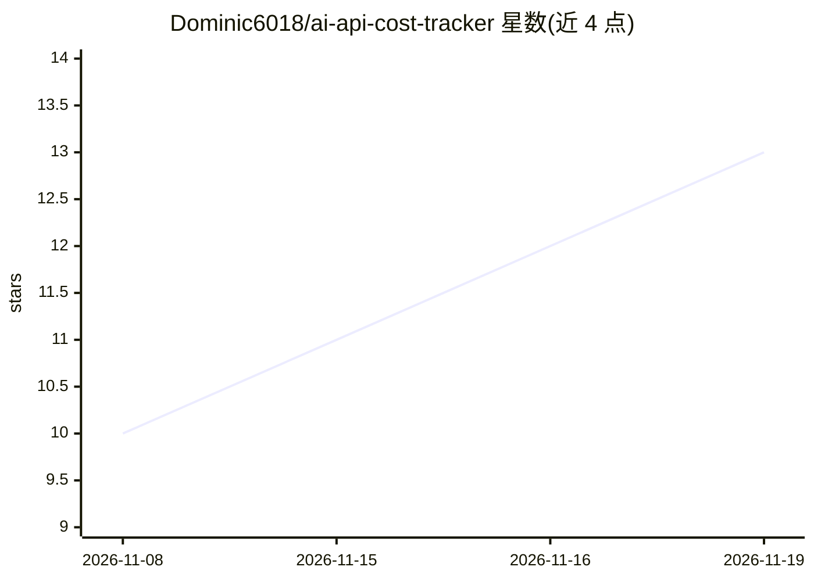

# Dominic6018/ai-api-cost-tracker

⭐ 13 · TypeScript · MIT · 推送 2026-11-17 · [GitHub](https://github.com/Dominic6018/ai-api-cost-tracker) · 个人维护

**自托管 AI API 成本记账工具：按项目/客户/模型追踪开销**

自托管的 AI API 调用成本台账：应用上报每次请求的 token 数，系统按带日期、分层级的模型价格精确计价，提供按项目、提供商、模型、客户、功能与 agent run 的开销拆解，含月度预算告警、OpenTelemetry 采集、与 Anthropic/OpenAI/Google 账单对账、CSV/FOCUS 导出、计费账本与 Stripe 草稿发票。不发送或存储提示词与响应，仅记录 token 数。Docker Compose 或 Vercel 部署，MIT 许可。

## 筛选速览

| 维度 | 判定 | 备注 |
|---|---|---|
| AI 角色 | `ai-ecosystem` | LLM/agent 周边工具 |
| 许可风险 | `permissive` | MIT |
| 部署形态 | `self-host` | docker 或自建部署 |
| 模型依赖 | — | README 未给出锁定关系 |
| 硬件要求 | — | 无带数字的原话,不猜 |
| 安装摩擦 | `low` | 无编译、无系统依赖或容器化 |
| 成熟度 | — | 结构信号不足 |

## 能力要点

- 按日期与层级版本化的精确计价，金额用精确小数存储
- TypeScript/Python 客户端从 OpenAI、Anthropic、Gemini 响应读取用量，也支持 OpenTelemetry trace 采集
- 每项目月度预算，80%/100% 阈值告警至 webhook/Slack/邮件，支持预留预算防并发超支
- 支持与提供商账单对账（npm run reconcile）、计费账本与 Stripe 草稿发票

## 适用场景

- 按项目、客户和功能维度追踪团队的 AI API 开销
- 为每个项目设置月度预算并在超支前收到告警
- 将记录的成本与 OpenAI/Anthropic/Google 账单对账
- 向客户出具含 AI 成本的账单与收入-成本视图

## 场景标签

 · 领域:LLM 基础设施/成本管理

## 证据(README 行号)

> L3: A lightweight, self-hosted ledger of what your AI API calls cost. Your app sends the token counts from each request;
> L17: > **Status:** Milestones 0–9 are complete: exact, tier-aware pricing, authenticated ingestion, the dashboard, budge

## 星数曲线

2026-11-08 10 → 2026-11-19 13（+3）

---
*卡片 v1 · prompt 1.4 · 生成 2026-11-18 · 置信度 high · 依据 README sha `eef884cd2b28` · [字段定义](../../DATASET.md)*
