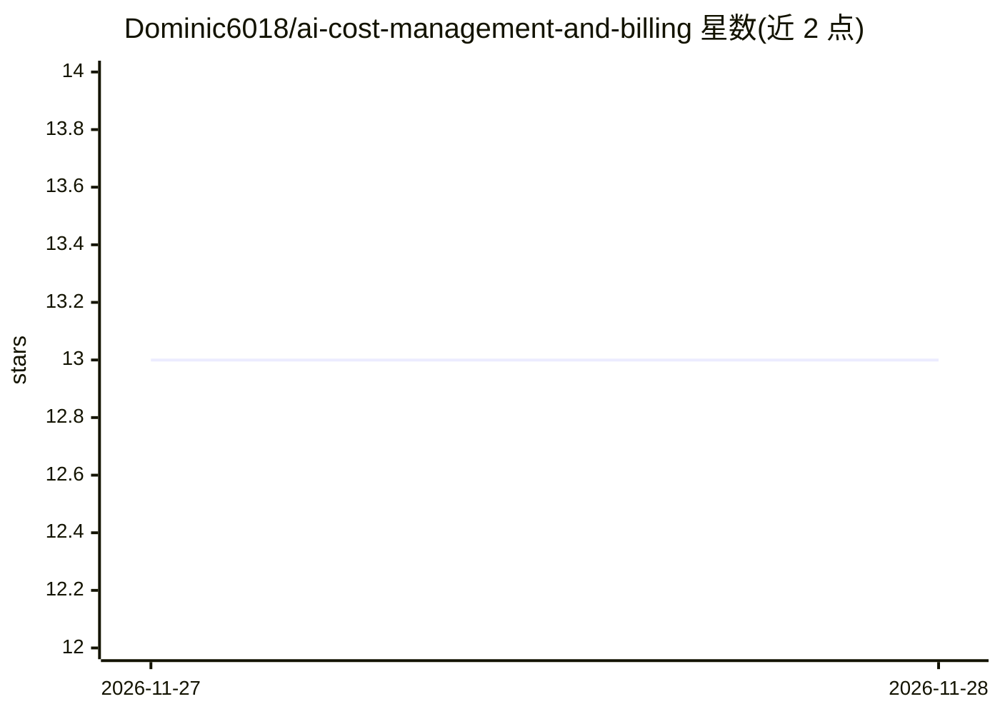

# Dominic6018/ai-cost-management-and-billing

⭐ 13 · TypeScript · MIT · 推送 2026-11-27 · [GitHub](https://github.com/Dominic6018/ai-cost-management-and-billing) · [官网](https://ai-cost-management-and-billing.vercel.app) · 个人维护

**给 AI 应用企业追踪每笔 API 成本并按用量向客户计费**

自托管的开源 AI 财务基础设施平台：应用上报每次请求的 token 用量（不传提示词与响应内容），按生效时点价格精确计价，区分缓存输入、批处理、长提示分级、音频、图像与网络搜索费用；支出按项目、模型、客户、用户、功能等维度拆解，与 Anthropic/OpenAI/Google 账单对账。内置预算预留与告警（webhook/Slack/邮件）、计费账本与 Stripe 草稿发票、客户收入与成本对照页面。通过 Docker Compose 或 Vercel 部署，MIT 许可，0.1.0 版本。

## 筛选速览

| 维度 | 判定 | 备注 |
|---|---|---|
| AI 角色 | `ai-ecosystem` | LLM/agent 周边工具 |
| 许可风险 | `permissive` | MIT |
| 部署形态 | `self-host` | docker 或自建部署 |
| 模型依赖 | locked-api |  |
| 硬件要求 | — | 无带数字的原话,不猜 |
| 安装摩擦 | `low` | 无编译、无系统依赖或容器化 |
| 成熟度 | `idea` | |

## 能力要点

- 按请求时点价格精确计价，缓存/批量/分级/音频/图像/搜索分别收费
- 按客户、项目、模型、用户等维度拆解支出并与供应商账单对账
- 预算预留机制防止并发步骤超支，80%/100% 阈值告警
- 计费账本与客户门户：按用量开票并展示客户利润率

## 适用场景

- AI SaaS 公司按客户计费并核算每个客户的 AI 成本与利润
- 多租户 AI 应用的共享预算管控与超支告警
- 将记录的支出与 Anthropic/OpenAI/Google 账单核对

## 场景标签

 · 领域:AI FinOps/计费基础设施

## 证据(README 行号)

> L3: **AI Cost Intelligence & Usage-Based Billing Platform** · AI FinOps & Billing Infrastructure
> L11: MeterVanta complements LLM gateways (which route requests and cap spend) and tracing tools (which follow a request 
> L31: - **Multi-provider visibility: all of your AI spend in one place.** OpenAI, Anthropic and Google Gemini through dro

## 星数曲线

2026-11-27 13 → 2026-11-28 13（+0）

---
*卡片 v1 · prompt 1.4 · 生成 2026-11-27 · 置信度 high · 依据 README sha `b8ae9d212bee` · [字段定义](../../DATASET.md)*
