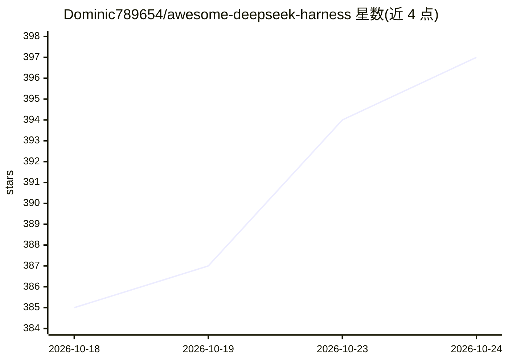

# Dominic789654/awesome-deepseek-harness

⭐ 397 · TypeScript · NOASSERTION · 推送 2026-10-23 · [GitHub](https://github.com/Dominic789654/awesome-deepseek-harness) · 个人维护 · 中文 README

**DeepSeek Harness（DSH）生态插件策展清单**

面向 DeepSeek Harness（DeepSeek 官方 agent 运行时）的社区策展清单，收录插件、技能、MCP 服务器、patch/profile 层、编排器与 UI 等生态项目，按近期新增与官方精选组织。条目附星标数、安装命令（dsh plugin add）与团队推荐原文，要求被收录仓库携带 #dsh GitHub topic 以便索引。README 为中英双语，提供 Quick Start 命令与官方仓库链接，本身不含可运行代码。

## 筛选速览

| 维度 | 判定 | 备注 |
|---|---|---|
| AI 角色 | `ai-knowledge` | 知识聚合/清单类 |
| 许可风险 | `none` | NOASSERTION |
| 部署形态 | `desktop` | 安装包/桌面程序 |
| 模型依赖 | — | README 未给出锁定关系 |
| 硬件要求 | — | 无带数字的原话,不猜 |
| 安装摩擦 | `low` | 无编译、无系统依赖或容器化 |
| 成熟度 | — | 结构信号不足 |

## 能力要点

- 收录插件、技能、MCP 服务器、profile 层、编排器与 UI 等类目
- 含官方团队推荐（Official Picks）与近 7 天新增（自动生成）分区
- 条目附 dsh plugin add 安装命令与星标数
- 要求被收录项目携带 #dsh GitHub topic

## 适用场景

- 为 DSH 运行时查找社区插件、技能与 UI
- 了解 DeepSeek Harness 插件生态的构成与官方推荐
- 插件作者提交自己的 #dsh 仓库进入索引

## 场景标签

`精选清单` · 领域:学习与行业

## 证据(README 行号)

> L12: > A curated list of **plugins, skills, MCP servers, patch/profile layers, orchestrators, aggregators & UIs** for **
> L16: DeepSeek Harness ("DSH") is DeepSeek's agent runtime / harness layer — the "hands" that turn the model's reasoning 

## 星数曲线

2026-10-18 385 → 2026-10-24 397（+12）

---
*卡片 v1 · prompt 1.4 · 生成 2026-10-22 · 置信度 mid · 依据 README sha `45d3f8d2184f` · [字段定义](../../DATASET.md)*
