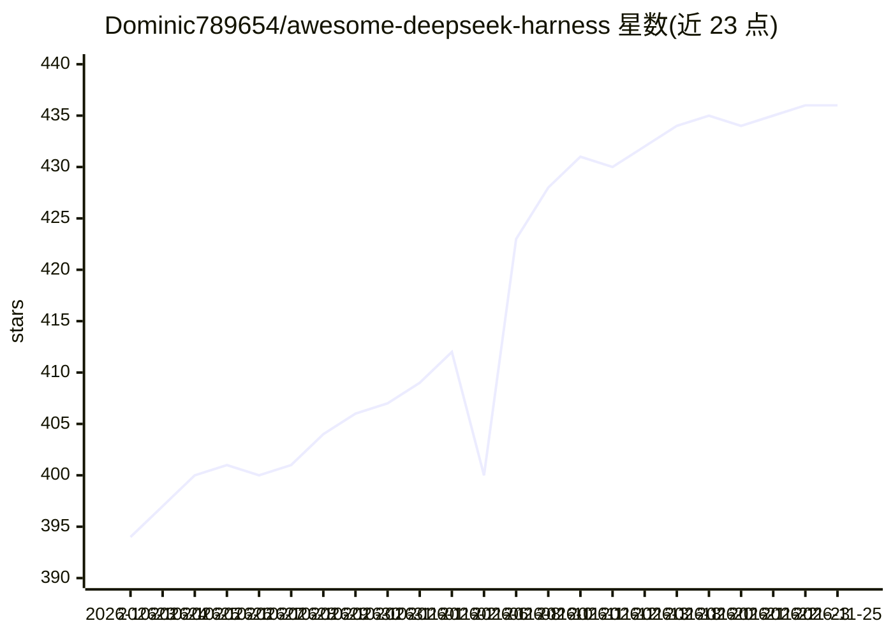

# Dominic789654/awesome-deepseek-harness

⭐ 436 · TypeScript · NOASSERTION · 推送 2026-11-23 · [GitHub](https://github.com/Dominic789654/awesome-deepseek-harness) · 组织维护 · 中文 README

**为 DeepSeek Harness（DSH）生态收录插件/技能/MCP 服务器的清单**

围绕 DeepSeek 官方 agent 运行时 DeepSeek Harness（DSH）维护的社区生态清单，按官方精选、插件目录、Profiles 与补丁层等分类收录仓库条目，附星标数与入选日期。收录机制依赖 GitHub `#dsh` topic 供发现与索引，接受社区 PR 投稿，另收录 DSH 团队负责人在 X 上推荐的插件系列并保持与中文版 README 同步。快速启动部分给出 DSH Web UI 的 npx 启动命令与插件安装命令。

## 筛选速览

| 维度 | 判定 | 备注 |
|---|---|---|
| AI 角色 | `ai-knowledge` | 知识聚合/清单类 |
| 许可风险 | `none` | NOASSERTION |
| 部署形态 | `desktop` | 安装包/桌面程序 |
| 模型依赖 | — | README 未给出锁定关系 |
| 硬件要求 | — | 无带数字的原话,不猜 |
| 安装摩擦 | `low` | 无编译、无系统依赖或容器化 |
| 成熟度 | — | 结构信号不足 |

## 能力要点

- 按官方精选/插件目录/Profiles & Patch Layers 等分类收录生态仓库
- 通过 GitHub `#dsh` topic 与 PR 流程实现收录与发现
- 收录 DSH 团队负责人在 X 的推荐系列并链接原帖
- 提供中英双语 README 并保持同步

## 适用场景

- 为 DSH 查找和安装社区插件、技能或 MCP 服务器
- 了解 DSH 插件生态的最新收录动态
- 插件作者按 `#dsh` 规范提交自己的仓库

## 场景标签

`精选清单` · 领域:学习与行业

## 证据(README 行号)

> L12: > A curated list of **plugins, skills, MCP servers, patch/profile layers, orchestrators, aggregators & UIs** for **
> L16: DeepSeek Harness ("DSH") is DeepSeek's agent runtime / harness layer — the "hands" that turn the model's reasoning 
> L18: This list collects the best of that ecosystem. Contributions welcome — see Contributing.

## 星数曲线

2026-10-23 394 → 2026-11-25 436（+42）

---
*卡片 v1 · prompt 1.4 · 生成 2026-11-25 · 置信度 mid · 依据 README sha `4f74273a6716` · [字段定义](../../DATASET.md)*
