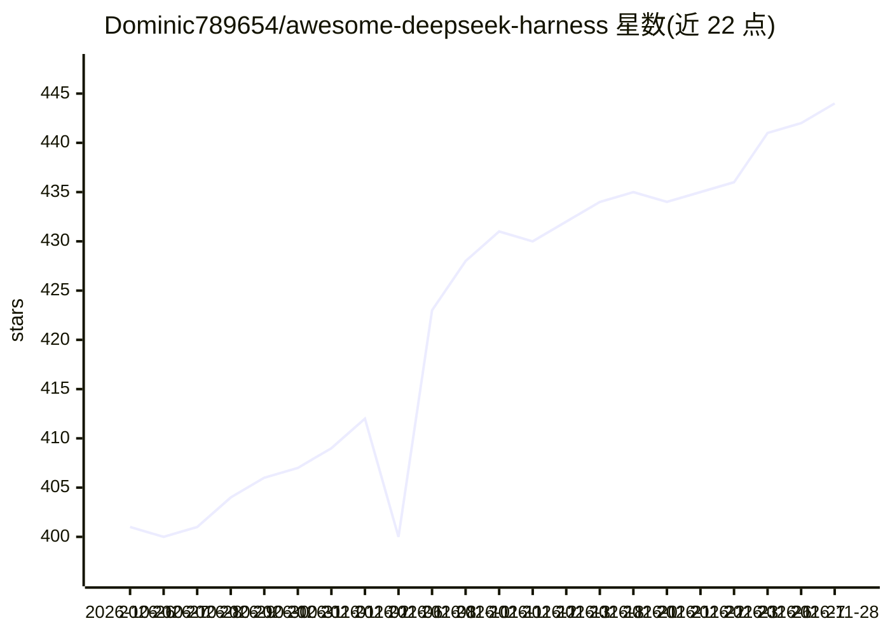

# Dominic789654/awesome-deepseek-harness

⭐ 444 · TypeScript · NOASSERTION · 推送 2026-11-27 · [GitHub](https://github.com/Dominic789654/awesome-deepseek-harness) · 个人维护 · 中文 README

**DeepSeek Harness（DSH）插件与技能生态策展清单**

面向 DeepSeek Harness 官方 agent 运行时（`Model + Harness = Agent`）的社区资源清单，收录插件、技能、MCP 服务器、profile/patch 层、编排器与 UI。条目按规则注入、记忆、搜索、终端 UI、插件市场等类别组织，含每周新增自动汇总脚本与团队负责人推荐的 Official Picks。安装路径为 npx 启动 DSH Web UI 后经 `dsh plugin add` 装入条目仓库；要求被收录仓库带 `#dsh` GitHub 主题。

## 筛选速览

| 维度 | 判定 | 备注 |
|---|---|---|
| AI 角色 | `ai-knowledge` | 知识聚合/清单类 |
| 许可风险 | `none` | NOASSERTION |
| 部署形态 | `desktop` | 安装包/桌面程序 |
| 模型依赖 | locked-api |  |
| 硬件要求 | — | 无带数字的原话,不猜 |
| 安装摩擦 | `low` | 无编译、无系统依赖或容器化 |
| 成熟度 | — | 结构信号不足 |

## 能力要点

- 按规则注入、长期记忆、搜索、TUI、profile 层等类别组织 400+ 条目
- 最近 7 天新增条目由脚本自动生成
- 收录 DeepSeek Harness 团队负责人的官方推荐系列
- 中英双语版本（README 与 README.zh-CN.md 保持同步）

## 适用场景

- 为 DSH 查找记忆管理、搜索、规则注入等插件
- 插件作者按 `#dsh` 主题提交收录并了解迁移技能
- 通过 dshmarket/awesome-dsh-plugin 等导航站浏览插件生态

## 场景标签

 · 领域:LLM 生态/插件目录

## 证据(README 行号)

> L12: > A curated list of **plugins, skills, MCP servers, patch/profile layers, orchestrators, aggregators & UIs** for **
> L18: This list collects the best of that ecosystem. Contributions welcome — see Contributing.
> L43: ## Quick Start

## 星数曲线

2026-10-26 401 → 2026-11-28 444（+43）

---
*卡片 v1 · prompt 1.4 · 生成 2026-11-28 · 置信度 high · 依据 README sha `ddbc24abfbd1` · [字段定义](../../DATASET.md)*
