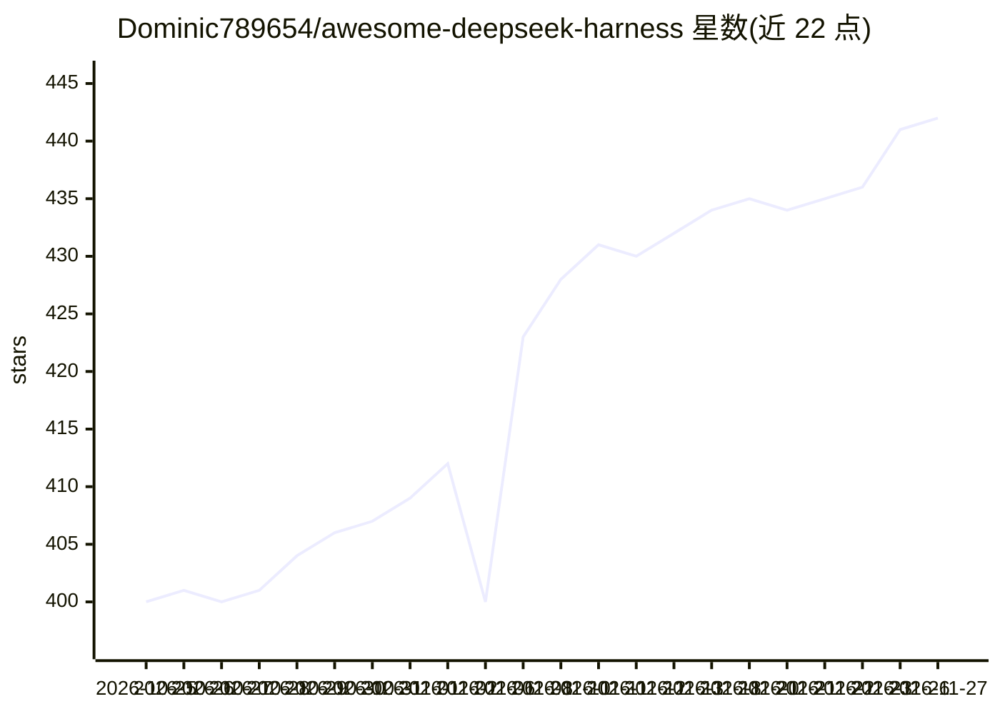

# Dominic789654/awesome-deepseek-harness

⭐ 442 · TypeScript · NOASSERTION · 推送 2026-11-26 · [GitHub](https://github.com/Dominic789654/awesome-deepseek-harness) · 组织维护 · 中文 README

**面向 DSH 的插件/技能/MCP 服务器生态目录**

围绕 DeepSeek Harness（DSH）的社区生态清单，收录插件、技能、MCP 服务器、补丁/Profile 层、编排预设与 UI 等条目。DSH 是 DeepSeek 的 agent 运行时，遵循 'Model + Harness = Agent' 的插件化架构。清单包含近期新增（7 天）区块、由 DSH 团队负责人推荐条目组成的精选区，并提供 Quick Start 命令：通过 npx 启动 DSH Web UI、使用 `dsh plugin --profile web add` 安装列表中的插件。要求收录仓库携带 #dsh 主题标签以便被索引。

## 筛选速览

| 维度 | 判定 | 备注 |
|---|---|---|
| AI 角色 | `ai-knowledge` | 知识聚合/清单类 |
| 许可风险 | `none` | NOASSERTION |
| 部署形态 | `desktop` | 安装包/桌面程序 |
| 模型依赖 | locked-api |  |
| 硬件要求 | — | 无带数字的原话,不猜 |
| 安装摩擦 | `low` | 无编译、无系统依赖或容器化 |
| 成熟度 | — | 结构信号不足 |

## 能力要点

- 收录插件、技能、MCP 服务器、profile/补丁层、编排预设与 UI 等多类条目
- 官方团队负责人在 X 上的推荐条目与原帖链接
- 提供 npx 启动 DSH Web UI 与 dsh plugin 安装插件的 Quick Start 命令
- 支持英文/简体中文双语维护，与 README.zh-CN.md 同步

## 适用场景

- 为 DSH agent 运行时查找可安装的社区插件与技能
- 浏览 DSH 插件市场的导航站点与评分体系
- 寻找长程任务、数学推理等任务专用的 profile 配置

## 场景标签

`精选清单` · 领域:学习与行业

## 证据(README 行号)

> L12: > A curated list of **plugins, skills, MCP servers, patch/profile layers, orchestrators, aggregators & UIs** for **
> L18: This list collects the best of that ecosystem. Contributions welcome — see Contributing.

## 星数曲线

2026-10-25 400 → 2026-11-27 442（+42）

---
*卡片 v1 · prompt 1.4 · 生成 2026-11-27 · 置信度 high · 依据 README sha `0982425353f0` · [字段定义](../../DATASET.md)*
