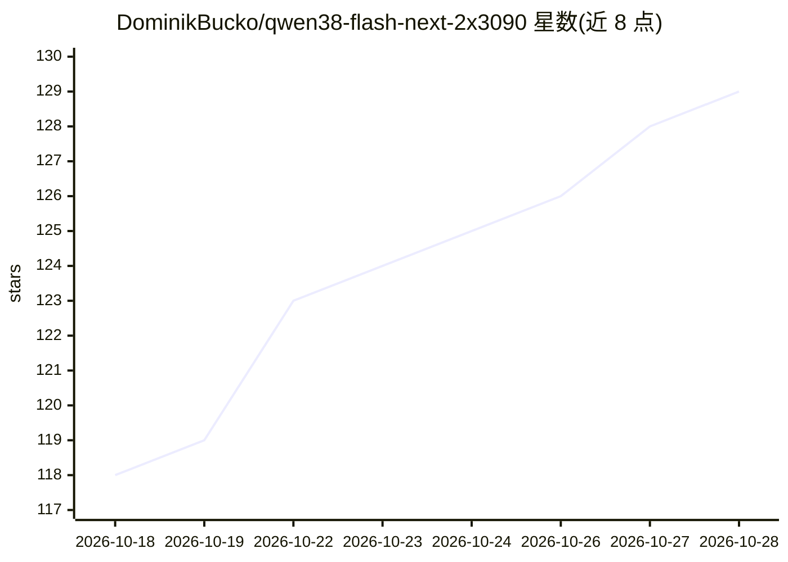

# DominikBucko/qwen38-flash-next-2x3090

⭐ 129 · Python · Apache-2.0 · 推送 2026-10-15 · [GitHub](https://github.com/DominikBucko/qwen38-flash-next-2x3090) · [官网](https://huggingface.co/albucino/Qwen3.8-Flash-Next-W4A16-FP8PLE) · 个人维护

**在 2×RTX 3090 上高速运行 Qwen3.8-Flash-Next 的推理构建**

面向本地部署者的 vLLM 补丁构建：将 Qwen3.8-Flash-Next 的 AutoRound W4A16 权重与 FP8 PLE/ngram 张量装入系统内存，GPU 上以 LRU 缓存活跃专家，配合 MTP3 drafter 提升解码速度，在 2×RTX 3090 + 128GB 内存下实现最高 4,191 tok/s 预填充与 111.5 tok/s 解码、完整 256K 上下文；另有 64GB 内存档位与单卡 3090 方案。新增可选 uncensored 模式，运行时做 abliteration 投影而不改权重。通过 .env 配置切换档位并以 make serve 运行。

## 筛选速览

| 维度 | 判定 | 备注 |
|---|---|---|
| AI 角色 | `ai-ecosystem` | LLM/agent 周边工具 |
| 许可风险 | `permissive` | Apache-2.0 |
| 部署形态 | `None` |  |
| 模型依赖 | local-ok | 支持本地模型 |
| 硬件要求 | — | 无带数字的原话,不猜 |
| 安装摩擦 | `medium` | 含编译或系统依赖之一 |
| 成熟度 | — | 结构信号不足 |

## 能力要点

- 128GB 档位：131K 提示下 4,191 tok/s 预填充、111.5 tok/s 解码，支持完整 256K 窗口
- 64GB 内存档位与单卡 RTX 3090 运行方案
- 可选 uncensored 模式：运行时 abliteration，不新增权重、不影响速度
- CPU 专家卸载 + GPU LRU 专家缓存 + MTP3 投机解码的推理优化

## 适用场景

- 在双卡 3090 消费级硬件上本地部署长上下文 MoE 模型
- 内存受限（64GB）主机上运行 128K 上下文推理
- 对模型拒绝行为做研究或红队测试（opt-in uncensored 模式）

## 场景标签

`推理引擎` `模型量化` · 领域:训练与推理

## 证据(README 行号)

> L24: tensors, to fit into 128GB memory. The serving code is a pinned vLLM build plus the
> L19: Qwen3.8-Flash-Next, with its high sparsity and low active param count is a great candidate for CPU offloading under

## 星数曲线

2026-10-18 118 → 2026-10-28 129（+11）

---
*卡片 v1 · prompt 1.4 · 生成 2026-10-23 · 置信度 high · 依据 README sha `6d6cf1778a40` · [字段定义](../../DATASET.md)*
