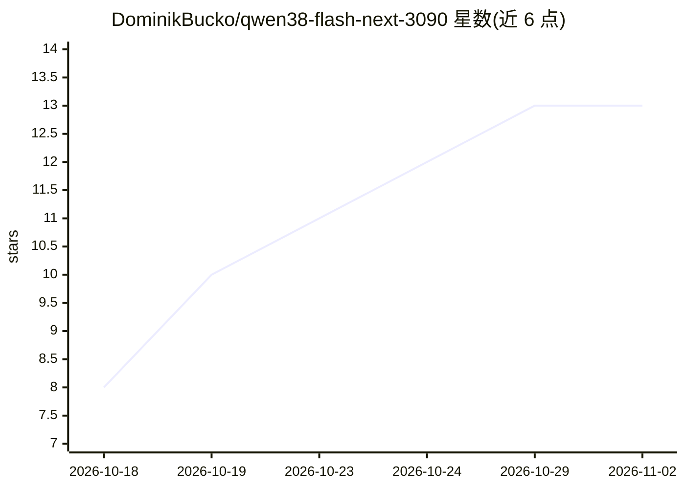

# DominikBucko/qwen38-flash-next-3090

⭐ 13 · Python · Apache-2.0 · 推送 2026-09-30 · [GitHub](https://github.com/DominikBucko/qwen38-flash-next-3090) · [官网](https://huggingface.co/albucino/Qwen3.8-Flash-Next-W4A16-FP8PLE) · 个人维护

**在单张 RTX 3090 + 64 GB 内存上运行 Qwen3.8-Flash-Next 的推理运行时**

基于 vLLM 的模型部署方案：将 INT4 量化（125 GB）的 Qwen3.8-Flash-Next 完整运行在一张 24 GB 显卡上。机制为热 MoE 专家驻留 GPU、冷专家由 CPU 直接从内存计算、最少使用的专家从 NVMe 原位读取，配合 INT8 KV cache 容纳 128K 上下文。提供 Docker 镜像、OpenAI 兼容 API、工具调用与推理输出。限制：同时仅一个请求、仅 Linux、仅在单台机器上测试过。

## 筛选速览

| 维度 | 判定 | 备注 |
|---|---|---|
| AI 角色 | `ai-ecosystem` | LLM/agent 周边工具 |
| 许可风险 | `permissive` | Apache-2.0 |
| 部署形态 | `library` | 以包/库形式分发 |
| 模型依赖 | local-ok | 支持本地模型 |
| 硬件要求 | `gpu-8g` | |
| 安装摩擦 | `medium` | 含编译或系统依赖之一 |
| 成熟度 | `idea` | |

## 能力要点

- 热专家留 GPU、冷专家 CPU 计算、NVMe 原位读取的三级放置
- 128K 上下文依赖 INT8 KV cache
- 提供 OpenAI 兼容 API，支持工具调用与 reasoning 输出
- Docker 镜像含 preflight 硬件检查脚本

## 适用场景

- 在单张 24 GB 消费级显卡机器上本地部署长上下文 MoE 模型
- 通过 OpenAI 兼容客户端调用本地 Qwen3.8-Flash-Next
- 处理 131K token 级别长提示词的推理请求

## 场景标签

`推理引擎` · 领域:训练与推理

## 证据(README 行号)

> L4:  One RTX 3090 24 GB · 64 GB system RAM · vLLM · OpenAI-compatible API · Docker
> L19: It is the same checkpoint and the same vLLM build as the

## 星数曲线

2026-10-18 8 → 2026-11-02 13（+5）

---
*卡片 v1 · prompt 1.4 · 生成 2026-10-31 · 置信度 mid · 依据 README sha `043ccf8f4c80` · [字段定义](../../DATASET.md)*
