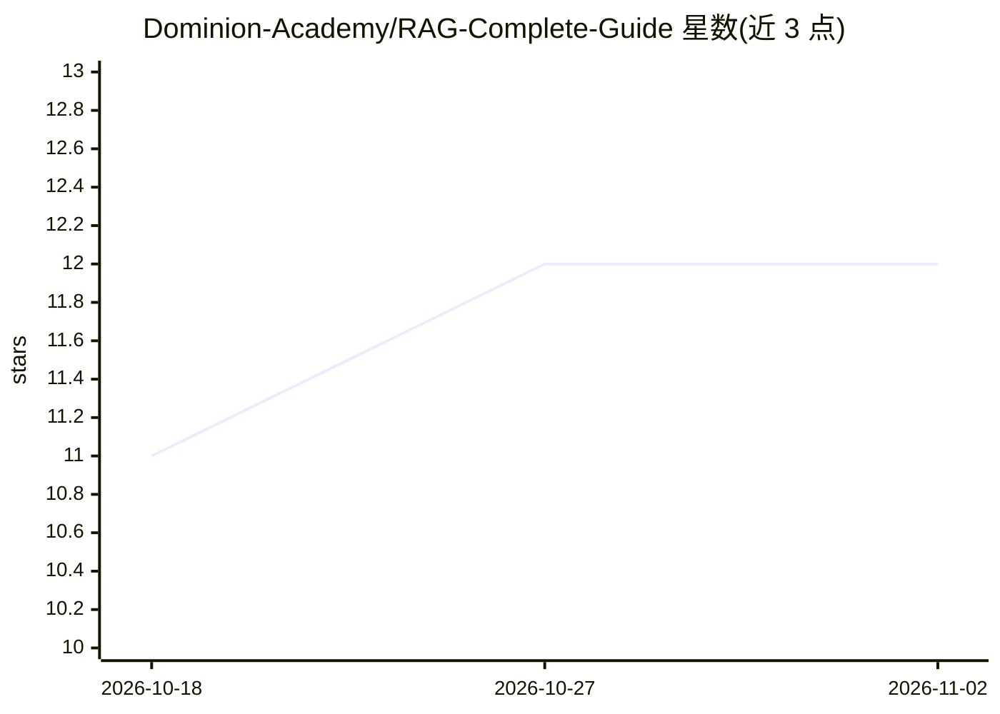

# Dominion-Academy/RAG-Complete-Guide

⭐ 12 · Python · 推送 2026-10-26 · [GitHub](https://github.com/Dominion-Academy/RAG-Complete-Guide) · 组织维护

**面向 LLM 应用开发者的 RAG 多路线教学课程仓库**

一个以代码示例为主的 RAG 课程仓库，覆盖向量检索 RAG、GraphRAG、SQL RAG、多模态 RAG、Agentic RAG 与 Web Search RAG 等主题。向量部分演示 FAISS、SQLite+sqlite-vec、pgvector、Qdrant、Chroma、Milvus 等多种后端，并含检索前改写、混合检索、检索后融合等完整流水线示例；评测部分使用 RAGAS、DeepEval、MLflow。使用 uv 创建 Python 3.12 虚拟环境并同步依赖运行。给希望系统学习各类 RAG 实现方式的开发者使用。

## 筛选速览

| 维度 | 判定 | 备注 |
|---|---|---|
| AI 角色 | `ai-knowledge` | 知识聚合/清单类 |
| 许可风险 | `none` | — |
| 部署形态 | `None` |  |
| 模型依赖 | — | README 未给出锁定关系 |
| 硬件要求 | — | 无带数字的原话,不猜 |
| 安装摩擦 | `low` | 无编译、无系统依赖或容器化 |
| 成熟度 | — | 结构信号不足 |

## 能力要点

- 覆盖向量、图、SQL、多模态、Agentic、Web Search 等多种 RAG 路线
- 示例覆盖 FAISS/Qdrant/Chroma/Milvus/pgvector/sqlite-vec 等多种向量后端
- 含 RAGAS/DeepEval/MLflow 的 RAG 评测模块
- 含检索前改写、混合检索、检索后融合的完整流水线示例

## 适用场景

- 系统学习从 ngram 到 GraphRAG 的各种 RAG 实现方式
- 对比不同向量数据库后端的 RAG 示例代码
- 为 RAG 项目搭建评测流程时参考课程示例

## 场景标签

`教程课程` `RAG` · 领域:知识与检索

## 证据(README 行号)

> L1: # RAG Complete Guide
> L5: ## Main topics
> L25: |Module|Topic|Examples|

## 星数曲线

2026-10-18 11 → 2026-11-02 12（+1）

---
*卡片 v1 · prompt 1.4 · 生成 2026-11-01 · 置信度 high · 依据 README sha `3a1e6f0bf7f1` · [字段定义](../../DATASET.md)*
