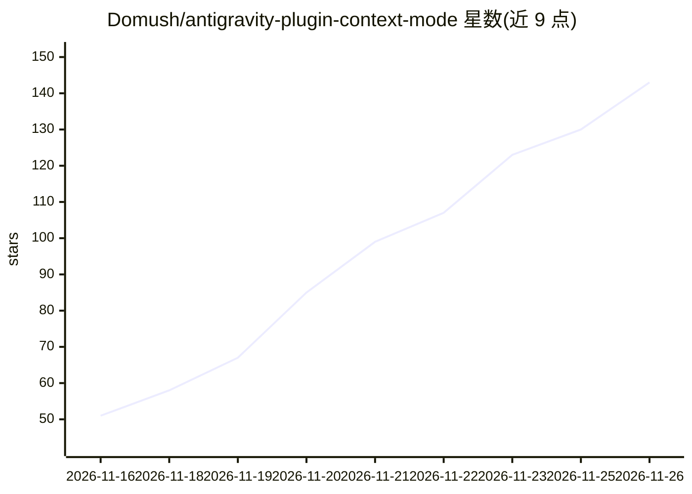

# Domush/antigravity-plugin-context-mode

⭐ 143 · JavaScript · MIT · 推送 2026-11-21 · [GitHub](https://github.com/Domush/antigravity-plugin-context-mode) · [官网](https://domush.github.io/antigravity-plugin-context-mode/) · 个人维护

**Google Antigravity 的本地上下文压缩插件：拦截大输出省 token**

面向 Google Antigravity App 的本地优先插件，用于管理 AI 编码代理的上下文窗口：在终端命令、构建日志与大文件读入对话前拦截，通过沙箱脚本提取答案、本地 SQLite FTS5 索引（BM25/三元组）分页检索，README 实测记录 92%-99% 的 token 节省。提供 8 个 MCP 工具（ctx_execute/ctx_search 等）与应用内侧边仪表盘；零运行时依赖、无网络调用，数据存于 ~/.context-mode/context.db。经 npx 安装，MIT 许可。

## 筛选速览

| 维度 | 判定 | 备注 |
|---|---|---|
| AI 角色 | `ai-ecosystem` | LLM/agent 周边工具 |
| 许可风险 | `permissive` | MIT |
| 部署形态 | `library` | 以包/库形式分发 |
| 模型依赖 | — | README 未给出锁定关系 |
| 硬件要求 | — | 无带数字的原话,不猜 |
| 安装摩擦 | `low` | 无编译、无系统依赖或容器化 |
| 成熟度 | — | 结构信号不足 |

## 能力要点

- 拦截大文件与命令输出，实测节省 92%-99% token
- 本地 SQLite FTS5 索引（BM25 + 三元组搜索），零网络调用
- 提供 8 个 MCP 工具（ctx_execute/ctx_search/ctx_index 等）
- 零运行时依赖，纯原生 Node.js（node:sqlite），无 node-gyp 构建

## 适用场景

- Antigravity 中长会话避免构建日志与日志文件塞满上下文
- 本地索引日志与文档供代理检索而不整段读入
- 查看 token 节省统计并调整文件读取截断阈值

## 场景标签

 · 领域:AI 编码代理工具/上下文管理

## 证据(README 行号)

> L11: **Antigravity Context Mode** is a free, local-first plugin built specifically for the **Google Antigravity App**. I
> L74: Once installed, Context Mode provides 8 specialized tools for your agent:

## 星数曲线

2026-11-16 51 → 2026-11-26 143（+92）

---
*卡片 v1 · prompt 1.4 · 生成 2026-11-18 · 置信度 high · 依据 README sha `dd7e903ef0ab` · [字段定义](../../DATASET.md)*
