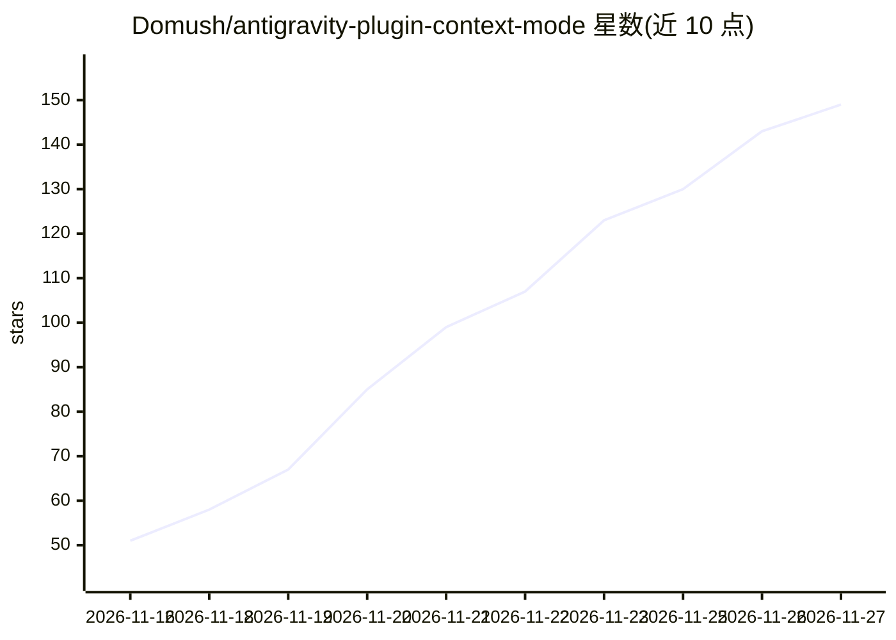

# Domush/antigravity-plugin-context-mode

⭐ 149 · JavaScript · MIT · 推送 2026-11-21 · [GitHub](https://github.com/Domush/antigravity-plugin-context-mode) · [官网](https://domush.github.io/antigravity-plugin-context-mode/) · 个人维护

**为 Antigravity 编码代理拦截大文件输出、节省上下文 token 的本地插件**

面向 Google Antigravity App 的本地优先插件：通过钩子拦截代理的文件读取与终端命令输出，对超过阈值的日志、源码做分块与索引，代理需检索时经本地 SQLite FTS5（BM25+trigram）返回带行号和作用域的片段，避免多兆字节内容灌入对话历史。提供 7 个 MCP 工具（执行、搜索、批量命令、统计等）、内置仪表盘显示节省指标。零运行时依赖，数据全部留在本地数据库，无网络调用。

## 筛选速览

| 维度 | 判定 | 备注 |
|---|---|---|
| AI 角色 | `ai-ecosystem` | LLM/agent 周边工具 |
| 许可风险 | `permissive` | MIT |
| 部署形态 | `library` | 以包/库形式分发 |
| 模型依赖 | — | README 未给出锁定关系 |
| 硬件要求 | — | 无带数字的原话,不猜 |
| 安装摩擦 | `low` | 无编译、无系统依赖或容器化 |
| 成熟度 | — | 结构信号不足 |

## 能力要点

- 工具读取钩子拦截，动态行数缩放与文件豁免控制
- AST/语法感知分块，覆盖 15+ 语言且保持类与方法完整
- 本地 SQLite FTS5 索引，BM25 + trigram RRF 检索
- 内置仪表盘实时显示 token 节省统计

## 适用场景

- 编码代理读取大型构建日志时避免上下文膨胀
- 大型源码文件按需检索而非整文件读入对话
- 在 Antigravity 中延长可用上下文、减少配额消耗

## 场景标签

`编码 Agent` · 领域:编码与开发

## 证据(README 行号)

> L11: **Antigravity Context Mode** is a free, local-first plugin built specifically for the **Google Antigravity App**. I
> L94: Once installed, Context Mode provides 7 specialized tools for your agent:

## 星数曲线

2026-11-16 51 → 2026-11-27 149（+98）

---
*卡片 v1 · prompt 1.4 · 生成 2026-11-27 · 置信度 high · 依据 README sha `2c4fc21207ba` · [字段定义](../../DATASET.md)*
