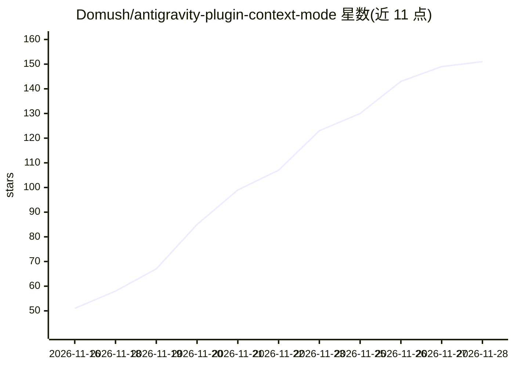

# Domush/antigravity-plugin-context-mode

⭐ 151 · JavaScript · MIT · 推送 2026-11-27 · [GitHub](https://github.com/Domush/antigravity-plugin-context-mode) · [官网](https://domush.github.io/antigravity-plugin-context-mode/) · 个人维护

**Google Antigravity 的上下文压缩插件：拦截大文件与命令输出**

专为 Google Antigravity App 构建的本地优先插件，拦截终端命令、构建日志与大文件读取，避免其涌入对话历史，按实测表格显示对日志解析、文件读取等操作节省 90%+ token。机制包括 hook 拦截、语言感知分块（AST 级、支持 15+ 语言）、本地 SQLite FTS5（BM25+trigram）检索，暴露 7 个 MCP 工具（ctx_execute/ctx_search 等），含实时统计仪表盘。纯 Node.js 实现，零运行时依赖，数据全部留在本地。

## 筛选速览

| 维度 | 判定 | 备注 |
|---|---|---|
| AI 角色 | `ai-ecosystem` | LLM/agent 周边工具 |
| 许可风险 | `permissive` | MIT |
| 部署形态 | `library` | 以包/库形式分发 |
| 模型依赖 | — | README 未给出锁定关系 |
| 硬件要求 | — | 无带数字的原话,不猜 |
| 安装摩擦 | `low` | 无编译、无系统依赖或容器化 |
| 成熟度 | — | 结构信号不足 |

## 能力要点

- 自动拦截无界文件读取与命令输出，防止上下文膨胀
- AST 与语法感知分块，保持类与方法完整（15+ 语言）
- 本地 SQLite FTS5 索引，BM25 + trigram RRF 搜索
- 提供 7 个 MCP 工具与 Antigravity 内置统计仪表盘

## 适用场景

- AI 编码代理读取大型日志或源文件时控制上下文消耗
- 避免长会话中出现 agent 遗忘早期约束的问题
- 在本地索引并检索项目文件而不上传数据

## 场景标签

`RAG` · 领域:知识与检索

## 证据(README 行号)

> L11: **Antigravity Context Mode** is a free, local-first plugin built specifically for the **Google Antigravity App**. I
> L94: Once installed, Context Mode provides 7 specialized tools under `context-mode_ctx` that return clean, readable Mark
> L71: * 🔍 **Local SQLite FTS5 Search**: Indexes files and logs locally on your machine with BM25 keyword matching and tri

## 星数曲线

2026-11-16 51 → 2026-11-28 151（+100）

---
*卡片 v1 · prompt 1.4 · 生成 2026-11-28 · 置信度 high · 依据 README sha `128e7e0963b4` · [字段定义](../../DATASET.md)*
