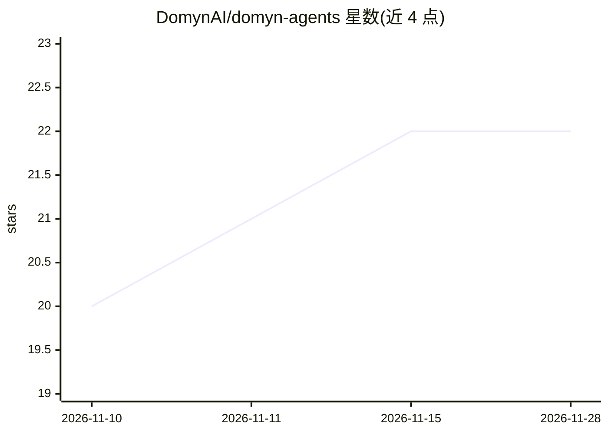

# DomynAI/domyn-agents

⭐ 22 · Python · Apache-2.0 · 推送 2026-11-27 · [GitHub](https://github.com/DomynAI/domyn-agents) · 组织维护

**Python/YAML 构建与运行 AI agent 的框架与终端客户端**

由 Domyn 团队维护的 Python agent 框架：可用 Python 库或 YAML 配置定义 agent，配备工具、多 agent 协作与人工审批机制；同时提供 `domyn run` 终端 agent，含设置向导、会话保存与恢复、上下文压缩。模型侧支持 vLLM、OpenAI、Anthropic、Cerebras、OpenRouter 及任意 OpenAI 兼容端点。可选扩展集成 OpenTelemetry tracing、LangChain、LangGraph、Slack、Telegram 与本地语音转文字。安装方式包括安装脚本、uv、pip。

## 筛选速览

| 维度 | 判定 | 备注 |
|---|---|---|
| AI 角色 | `ai-ecosystem` | LLM/agent 周边工具 |
| 许可风险 | `permissive` | Apache-2.0 |
| 部署形态 | `library` | 以包/库形式分发 |
| 模型依赖 | local-ok | 支持本地模型 |
| 硬件要求 | — | 无带数字的原话,不猜 |
| 安装摩擦 | `low` | 无编译、无系统依赖或容器化 |
| 成熟度 | — | 结构信号不足 |

## 能力要点

- Python 或 YAML 定义 agent，支持工具、多 agent 交接与人工审批
- 支持 vLLM、OpenAI、Anthropic、Cerebras、OpenRouter 及 OpenAI 兼容端点
- 终端 agent 提供设置向导、会话恢复与上下文压缩
- SKILL.md 技能文件与 SOUL.md/AGENTS.md 常驻指令

## 适用场景

- 在终端里以对话方式让 agent 读写项目文件并执行命令
- 用 Python/YAML 构建自定义多 agent 工作流
- 接入自有 vLLM 端点运行 agent

## 场景标签

`Agent 框架` `多智能体` · 领域:Agent 开发

## 证据(README 行号)

> L3: Build AI agents in Python or YAML, run them on any model, and work with them from the terminal.
> L16: Domyn Agents also allows to build your own agents. Define them with the Python library or a YAML config, give them 

## 星数曲线

2026-11-10 20 → 2026-11-28 22（+2）

---
*卡片 v1 · prompt 1.4 · 生成 2026-11-18 · 置信度 high · 依据 README sha `e30b56875e56` · [字段定义](../../DATASET.md)*
