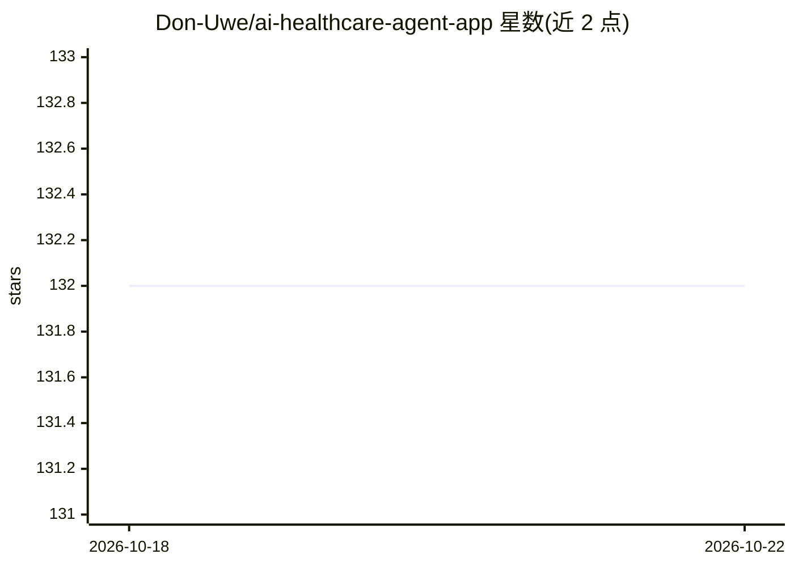

# Don-Uwe/ai-healthcare-agent-app

⭐ 132 · TypeScript · MIT · 推送 2026-10-19 · [GitHub](https://github.com/Don-Uwe/ai-healthcare-agent-app) · 个人维护

**健康资讯与播客的移动应用，含 AI 健康问答**

基于 Expo React Native 的开源移动平台，提供多语言健康文章、健康播客（含录制与离线收听）、社区协作审阅与信任信号、访客模式、健康仪表盘与 Firebase 推送通知。AI 部分为基于角色的健康问答聊天，后端可配置（环境变量中含 Gemini API key 用于 AI 摘要）。后端 API 与 MongoDB 位于独立仓库；Redis 缓存层为可选的开发工具。需 Node.js ≥ 20、Android Studio/Xcode 运行移动开发环境。

## 筛选速览

| 维度 | 判定 | 备注 |
|---|---|---|
| AI 角色 | `ai-enhanced` | 去掉 AI 部分产品仍成立 |
| 许可风险 | `permissive` | MIT |
| 部署形态 | `library` | 以包/库形式分发 |
| 模型依赖 | — | README 未给出锁定关系 |
| 硬件要求 | — | 无带数字的原话,不猜 |
| 安装摩擦 | `low` | 无编译、无系统依赖或容器化 |
| 成熟度 | — | 结构信号不足 |

## 能力要点

- 多语言健康文章的阅读与发布（含翻译工作流）
- 播客的流媒体、录制与离线支持
- 基于角色、后端可配置的 AI 健康问答聊天
- 社区协作编辑、信任信号与审核工具

## 适用场景

- 在手机上浏览和阅读健康文章与播客
- 通过 AI 聊天获取健康问答内容
- 以社区协作方式审阅健康内容

## 场景标签

`聊天机器人` · 领域:对话与助手

## 证据(README 行号)

> L3: Open-source mobile platform for trusted health articles, podcasts, AI-assisted wellness chat, and community-driven c
> L9: - **AI wellness chat** — Character-based health Q&A powered by configurable AI backends

## 星数曲线

2026-10-18 132 → 2026-10-22 132（+0）

---
*卡片 v1 · prompt 1.4 · 生成 2026-10-22 · 置信度 mid · 依据 README sha `ea39f26aad85` · [字段定义](../../DATASET.md)*
