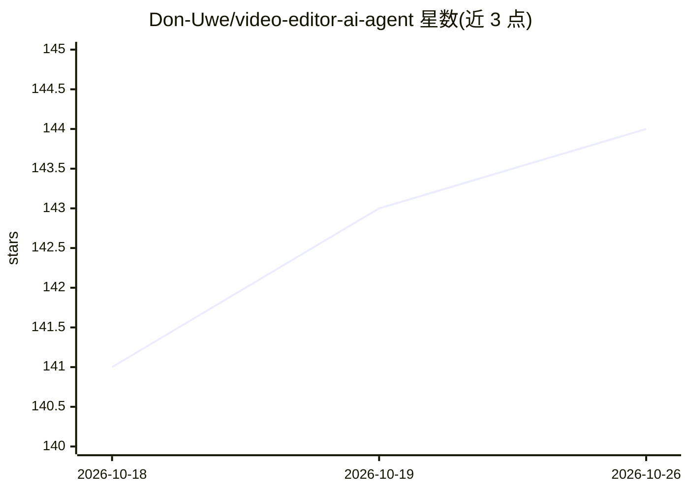

# Don-Uwe/video-editor-ai-agent

⭐ 144 · TypeScript · MIT · 推送 2026-09-14 · [GitHub](https://github.com/Don-Uwe/video-editor-ai-agent) · 个人维护

**输入素材与创意简报、由 agent 流水线自动剪辑成片的视频编辑器**

TypeScript monorepo 形式的 AI 视频编辑工具：CLI 为主接口，输入原始素材目录与创意简报（JSON），由 Director、Trim Refiner、Editor、Reviewer 四个 agent 按 YAML manifest 编排完成镜头选取、剪辑、渲染与质量审查；Reviewer 驱动重试循环，按阈值输出带版本号的成片。Web 端 AVE Studio（Next.js + Hono）为实验性非编界面，可选 Redis 持久化。依赖 Node.js 20+、FFmpeg 与 Google AI（Gemini）API key，面向开发者与视频内容生产流程。

## 筛选速览

| 维度 | 判定 | 备注 |
|---|---|---|
| AI 角色 | `ai-native` | 本体是模型或模型工具 |
| 许可风险 | `permissive` | MIT |
| 部署形态 | `library` | 以包/库形式分发 |
| 模型依赖 | — | README 未给出锁定关系 |
| 硬件要求 | — | 无带数字的原话,不猜 |
| 安装摩擦 | `medium` | 含编译或系统依赖之一 |
| 成熟度 | `idea` | |

## 能力要点

- Director/Trim Refiner/Editor/Reviewer 四 agent 按 YAML manifest 编排
- Reviewer 驱动的质量门控与重试，输出带版本号成片
- 实验性 AVE Studio Web UI（时间线、监视器、实时任务流）
- 可选 Redis 持久化，无 Redis 时功能优雅降级

## 适用场景

- 用 CLI 批量把原始素材按创意简报自动剪成广告短视频
- 通过流水线 YAML 与风格模板定制剪辑策略
- 在实验性 Web 界面中查看时间线与实时渲染任务

## 场景标签

`视频生成` `多智能体` · 领域:Agent 开发

## 证据(README 行号)

> L3: Production-oriented fork of an AI-assisted video pipeline. Feed raw footage and a creative brief; a coordinated agen
> L13: |Agent pipeline|Director, Trim Refiner, Editor, and Reviewer orchestrated from YAML manifests|

## 星数曲线

2026-10-18 141 → 2026-10-26 144（+3）

---
*卡片 v1 · prompt 1.4 · 生成 2026-10-22 · 置信度 high · 依据 README sha `cb6a0557abf7` · [字段定义](../../DATASET.md)*
