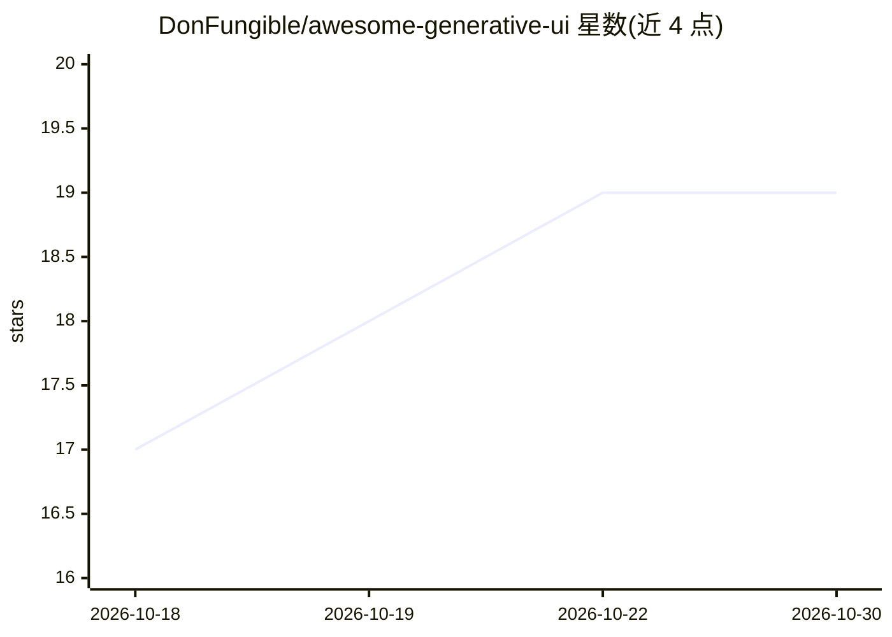

# DonFungible/awesome-generative-ui

⭐ 19 · CC0-1.0 · 推送 2026-10-27 · [GitHub](https://github.com/DonFungible/awesome-generative-ui) · 个人维护

**生成式 UI 开发与学习资源清单：规范/工具/论文/视频/应用**

由个人开发者维护的生成式 UI（模型生成结构化界面而非纯文本）资源策展清单。内容按实现（规范与协议、工具、技能）、学习（论文、视频、文章）与应用演示组织，收录 A2UI、AG-UI、MCP Apps 等协议及 AI SDK、CopilotKit、Tambo 等工具，论文条目按时间排序并附作者与日期。维护者在简介中声明持续更新链接。仓库本身不含代码，采用 CC0 1.0 许可。

## 筛选速览

| 维度 | 判定 | 备注 |
|---|---|---|
| AI 角色 | `ai-knowledge` | 知识聚合/清单类 |
| 许可风险 | `viral` | CC0-1.0 |
| 部署形态 | `None` |  |
| 模型依赖 | — | README 未给出锁定关系 |
| 硬件要求 | — | 无带数字的原话,不猜 |
| 安装摩擦 | `low` | 无编译、无系统依赖或容器化 |
| 成熟度 | — | 结构信号不足 |

## 能力要点

- 收录生成式 UI 的三种形态分类（受控/声明式/开放式）
- 覆盖规范协议（A2UI/AG-UI/MCP Apps）与 9 个工具条目
- 论文区收录 2017-2026 年生成式 UI 相关研究并按时间排序

## 适用场景

- 开发生成式 UI 应用前查找协议、标准与工具选型
- 追踪生成式 UI 领域的论文、视频与文章动态
- 了解生成式 UI 的分类与代表性应用演示

## 场景标签

`精选清单` · 领域:学习与行业

## 证据(README 行号)

> L3: This repo is a list of resources for building with and learning about generative UI. I curated it based on my experi
> L41: ## Learning

## 星数曲线

2026-10-18 17 → 2026-10-30 19（+2）

---
*卡片 v1 · prompt 1.4 · 生成 2026-10-29 · 置信度 high · 依据 README sha `4d39d9130824` · [字段定义](../../DATASET.md)*
