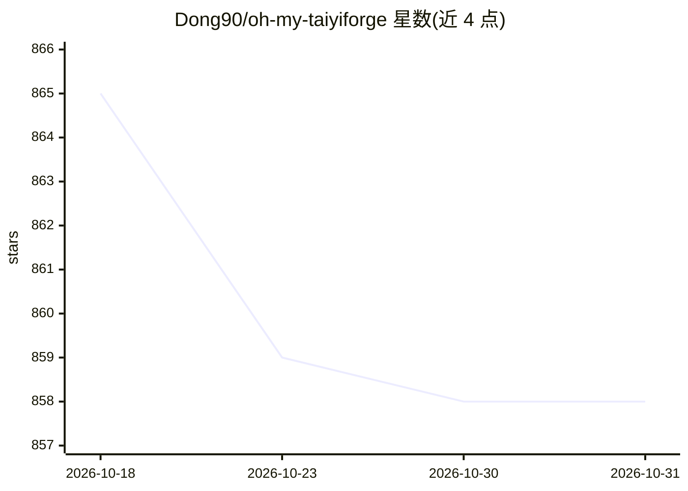

# Dong90/oh-my-taiyiforge

⭐ 858 · TypeScript · MIT · 推送 2026-10-12 · [GitHub](https://github.com/Dong90/oh-my-taiyiforge) · 组织维护 · 中文 README

**给 AI 编码终端的九阶段工程化流水线插件**

面向 Claude Code、Cursor、Codex、OpenCode 四类 AI 编码终端的 TypeScript 插件：以九阶段工件契约（change→…→integration）与状态机引擎约束 AI 编码流程，关键节点设人类审批门控；提供 21 条 slash 命令四端通用、强制 TDD 与 evidence 验证、token 压缩续传、ChangeGraph 依赖追踪及 10 种 profile。通过 npm 安装，支持 YAML 与 node_modules 扩展源，MIT 许可。

## 筛选速览

| 维度 | 判定 | 备注 |
|---|---|---|
| AI 角色 | `ai-ecosystem` | LLM/agent 周边工具 |
| 许可风险 | `permissive` | MIT |
| 部署形态 | `library` | 以包/库形式分发 |
| 模型依赖 | — | README 未给出锁定关系 |
| 硬件要求 | — | 无带数字的原话,不猜 |
| 安装摩擦 | `low` | 无编译、无系统依赖或容器化 |
| 成熟度 | `idea` | |

## 能力要点

- 九阶段流水线 + 人类门控（change/design/review 需人审批）
- 同一套命令在 Claude Code / Cursor / Codex / OpenCode 四端通用
- 强制 TDD 与每条 AC 配可执行验证命令
- token 压缩产出 CONTEXT-COMPACT.md，长会话断点续传

## 适用场景

- 让 AI 按固定工程流程完成需求到交付的变更
- 在多个 AI 编码工具间保持一致的团队流程
- 对 AI 产出做人类审批与证据化测试门控

## 场景标签

`编码 Agent` · 领域:编码与开发

## 证据(README 行号)

> L87: 不管是 Claude Code 的 `/taiyi:new`、Cursor 的同名 slash、Codex 的 `$taiyi-new`，还是 OpenCode 的插件工具——**同一套词汇，同一种行为**。
> L28: **TaiyiForge 的回答**：一套九阶段工件契约 + 状态机引擎。在四套 AI 终端里行为完全一致。
> L44: npm install oh-my-taiyiforge

## 星数曲线

2026-10-18 865 → 2026-10-31 858（-7）

---
*卡片 v1 · prompt 1.4 · 生成 2026-10-21 · 置信度 high · 依据 README sha `934574372458` · [字段定义](../../DATASET.md)*
