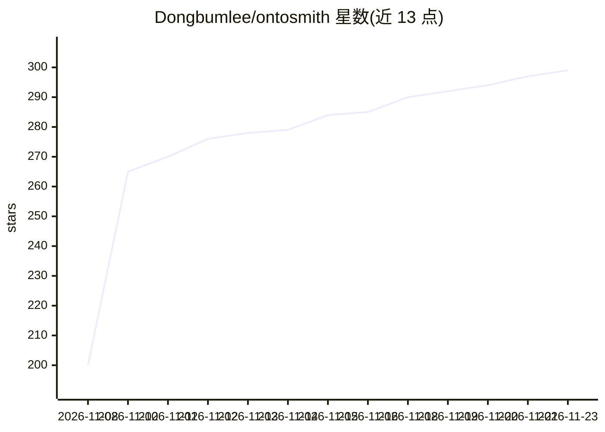

# Dongbumlee/ontosmith

⭐ 299 · Python · MIT · 推送 2026-11-20 · [GitHub](https://github.com/Dongbumlee/ontosmith) · [官网](https://dongbumlee.github.io/ontosmith/) · 个人维护

**本体驱动的知识图谱构建器：从文档产出带证据溯源的受治理图谱**

OntoSmith 是一个从文档语料构建知识图谱的流水线工具：先人工设计并批准本体（实体/关系类型的封闭清单），再由 LLM proposer 提出候选三元组，确定性门控与 Jev 决策模型判定后才写入 Neo4j 图数据库，每条三元组携带证据片段与出处。构建后可通过 search/API/MCP 提供句级证据检索与混合检索。非正式本体：无类层级、无推理。需 Python≥3.11，Linux 上开发测试（Windows 需 WSL2），构建阶段需 LLM 连接与 Neo4j 5.x。profiling/检验等步骤可无 key 运行。

## 筛选速览

| 维度 | 判定 | 备注 |
|---|---|---|
| AI 角色 | `ai-ecosystem` | LLM/agent 周边工具 |
| 许可风险 | `permissive` | MIT |
| 部署形态 | `library` | 以包/库形式分发 |
| 模型依赖 | locked-api |  |
| 硬件要求 | — | 无带数字的原话,不猜 |
| 安装摩擦 | `low` | 无编译、无系统依赖或容器化 |
| 成熟度 | — | 结构信号不足 |

## 能力要点

- 模型提议、Jev 决策模型判定的分离式构建，仅写入带证据三元组
- 确定性语料画像与本体构建/导入，hash 固定的 versioned pack
- 构建前成本预估与账本记录，可设 USD 停止线
- ontosmith search/serve/mcp 提供句级证据检索与 MCP 只读工具

## 适用场景

- 从合同或领域文档语料构建可审计的知识图谱
- 为 RAG/agent 提供带证据溯源的检索层
- 导入已有本体并按其受治理地构建图谱

## 场景标签

`知识图谱` · 领域:知识与检索

## 证据(README 行号)

> L9: **An ontology-driven knowledge-graph builder: design the
> L211: |Batch pipeline|The staged build: ingest → NER/roster → candidates → gates → route → write → index → verify, under
> L217: |Serving|Sentence-level evidence retrieval via `ontosmith search` (direct sentence index + graph pool + beam trave

## 星数曲线

2026-11-08 200 → 2026-11-23 299（+99）

---
*卡片 v1 · prompt 1.4 · 生成 2026-11-17 · 置信度 high · 依据 README sha `f5d9241390f7` · [字段定义](../../DATASET.md)*
