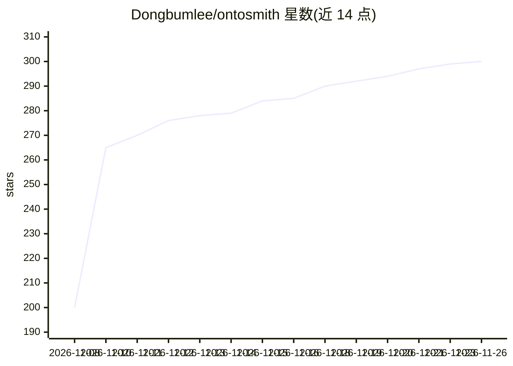

# Dongbumlee/ontosmith

⭐ 300 · Python · MIT · 推送 2026-11-25 · [GitHub](https://github.com/Dongbumlee/ontosmith) · [官网](https://dongbumlee.github.io/ontosmith/) · 个人维护

**给文档构建受治理、可溯源知识图谱的抽取管线**

以本体为先的知识图谱构建管线：先用确定性 corpus profiler 分析语料，人工审批后生成 hash 锁定的本体 pack，再由批处理管线分层构建图谱——LLM 提候选三元组，Jev 决策模型逐条裁决，仅写入带证据片段与出处的事实。构建写入 Neo4j（图遍历+向量+全文检索），提供 search/serve/API/MCP 等服务出口。构建需 LLM 连接与 Neo4j；分析、检索示例等步骤可无 key 运行；每次构建前给出成本预估并记录账本。

## 筛选速览

| 维度 | 判定 | 备注 |
|---|---|---|
| AI 角色 | `ai-native` | 本体是模型或模型工具 |
| 许可风险 | `permissive` | MIT |
| 部署形态 | `library` | 以包/库形式分发 |
| 模型依赖 | locked-api |  |
| 硬件要求 | — | 无带数字的原话,不猜 |
| 安装摩擦 | `low` | 无编译、无系统依赖或容器化 |
| 成熟度 | — | 结构信号不足 |

## 能力要点

- 提案/裁决分离的构建循环：候选事实经 Jev 决策模型逐条把关后才写入
- 每条写入三元组携带证据片段与 provenance
- 四领域 pack + Core 基线，本体以数据形式版本化并 hash 锁定
- 提供 search、示例 API 与五工具只读 MCP server 三类服务出口

## 适用场景

- 把合同、文档语料转成可溯源的领域知识图谱
- 基于构建好的图谱做证据级检索与问答
- 按领域定制或导入已有本体后批量构建图谱

## 场景标签

`知识图谱` `RAG` · 领域:知识与检索

## 证据(README 行号)

> L22: Most knowledge-graph tooling starts from whatever a model
> L27: that separates proposing from judging. Models propose
> L222: |Serving|Sentence-level evidence retrieval via `ontosmith search` (direct sentence index + graph pool + beam trave

## 星数曲线

2026-11-08 200 → 2026-11-26 300（+100）

---
*卡片 v1 · prompt 1.4 · 生成 2026-11-25 · 置信度 high · 依据 README sha `10da63733e63` · [字段定义](../../DATASET.md)*
