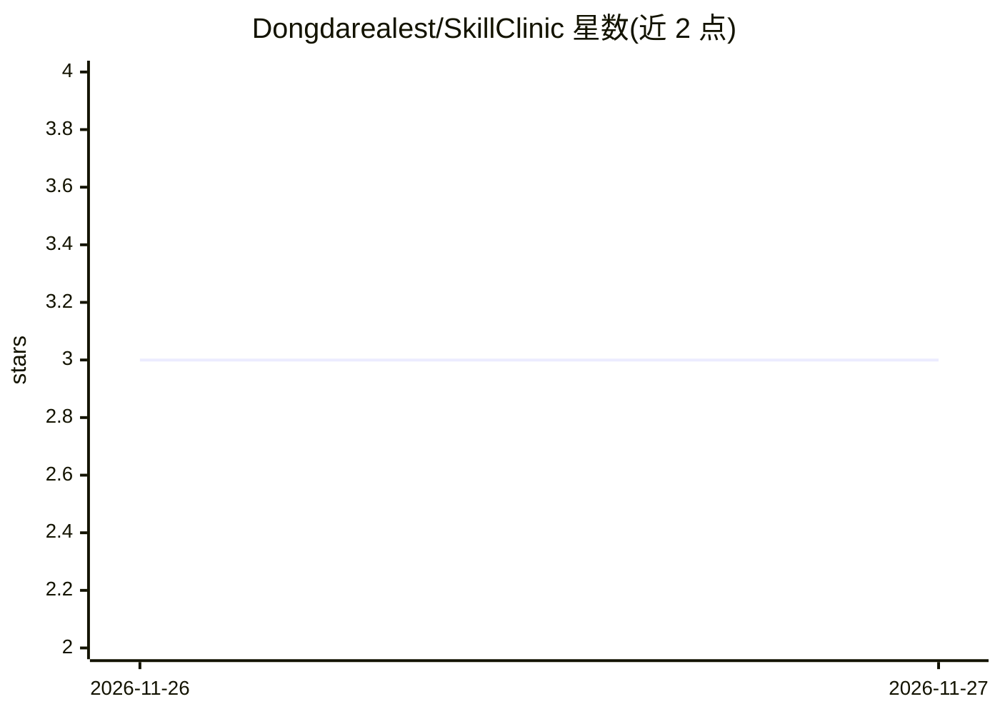

# Dongdarealest/SkillClinic

⭐ 3 · Python · MIT · 推送 2026-11-26 · [GitHub](https://github.com/Dongdarealest/SkillClinic) · [官网](https://dongdarealest.github.io/SkillClinic/) · 个人维护

**审计本机 AI skill 文件的零依赖安全检查 CLI**

一条命令扫描机器上安装的 AI skill 文件（AI 每次对话会加载并遵循的指令文件），从有效性（frontmatter 解析、命名规范）、安全风险（管道下载、凭据访问、数据外发语句、base64 blob、不可见 Unicode）、名称冲突、token 成本四个维度给出 OK/WARN/FAIL 判定与百分制评分，FAIL 附修复建议。支持 --json 输出接入 CI，可隔离并恢复失败 skill，可作 GitHub Action 使用；审计通过的项目可加入在线 registry 展示徽章。

## 筛选速览

| 维度 | 判定 | 备注 |
|---|---|---|
| AI 角色 | `ai-ecosystem` | LLM/agent 周边工具 |
| 许可风险 | `permissive` | MIT |
| 部署形态 | `library` | 以包/库形式分发 |
| 模型依赖 | — | README 未给出锁定关系 |
| 硬件要求 | — | 无带数字的原话,不猜 |
| 安装摩擦 | `low` | 无编译、无系统依赖或容器化 |
| 成熟度 | — | 结构信号不足 |

## 能力要点

- 零依赖单文件 CLI，仅需 Python 3.10+，也可 curl 一行安装并做 SHA-256 校验
- 安全检查覆盖凭据访问、数据外发、prompt 覆盖短语、不可见 Unicode 等 8 类模式
- --quarantine-failed 隔离失败 skill 且可 --restore 恢复
- GitHub Action 形式与每日复审计的公开徽章 registry

## 适用场景

- 安装社区 skill 前检查是否包含危险指令
- 在 CI 中每次 push 自动审计自家 skill 集合
- 排查同名或描述近似的 skill 冲突
- 统计 skill 的常驻 token 成本

## 场景标签

`网络安全` · 领域:学习与行业

## 证据(README 行号)

> L17: Skills are instruction files your AI loads and follows, often at the start of every conversation. Most people insta
> L3:  One command audits every AI skill on your machine and gives each one a verdict:

## 星数曲线

2026-11-26 3 → 2026-11-27 3（+0）

---
*卡片 v1 · prompt 1.4 · 生成 2026-11-26 · 置信度 high · 依据 README sha `760aa27bbc1e` · [字段定义](../../DATASET.md)*
