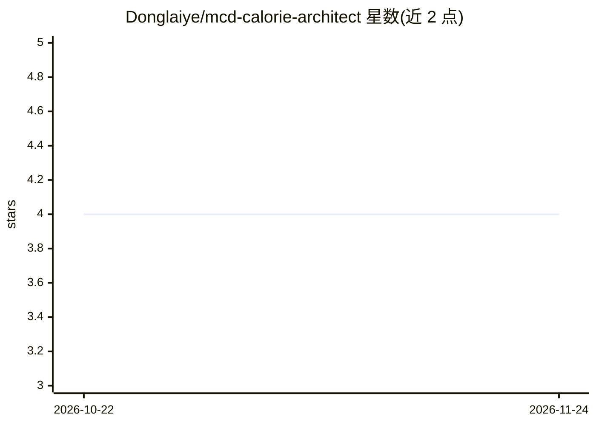

# Donglaiye/mcd-calorie-architect

⭐ 4 · Python · MIT · 推送 2026-10-11 · [GitHub](https://github.com/Donglaiye/mcd-calorie-architect) · 个人维护 · 中文 README

**基于麦当劳官方 MCP 真实营养数据的 AI 控卡配餐 Skill**

一个面向 AI Agent 的配餐 Skill：通过麦当劳中国官方 MCP 服务拉取真实营养与价格数据，在本地执行带约束的组合优化（热量上限、蛋白下限、预算上限、钠上限等），输出 Top3 配餐方案与运动换算（跑步公里数/步数）。核心机制是剪枝搜索、营养指纹去重与营养表/菜单数据源的 NFKC 归一化对齐，附带 20 项自测断言。安装方式为将 SKILL.md 与脚本复制到 Agent 技能目录，依赖用户自行申请 MCP Token。声明不构成医疗建议，非麦当劳官方产品。

## 筛选速览

| 维度 | 判定 | 备注 |
|---|---|---|
| AI 角色 | `ai-native` | 本体是模型或模型工具 |
| 许可风险 | `permissive` | MIT |
| 部署形态 | `None` |  |
| 模型依赖 | — | README 未给出锁定关系 |
| 硬件要求 | — | 无带数字的原话,不猜 |
| 安装摩擦 | `low` | 无编译、无系统依赖或容器化 |
| 成熟度 | — | 结构信号不足 |

## 能力要点

- 接入麦当劳中国官方 MCP 服务获取 160 条真实营养数据
- 本地约束求解（热量/蛋白/预算/钠），结果可复算可验证
- 营养表与门店菜单两套数据源的 NFKC 归一化三级匹配对齐
- 三个脚本内置 20 项自测断言，支持 --json 结构化输出

## 适用场景

- 减脂期按热量和蛋白预算在麦当劳点餐
- 查询一顿餐需要多少运动量消耗
- 控钠人群查看配餐的钠含量并加以约束
- 在热量与预算双重约束下选套餐

## 场景标签

 · 领域:生活工具/健康饮食

## 证据(README 行号)

> L3: > 输入「热量预算 + 想吃什么」，AI 用**麦当劳官方 MCP 的真实营养数据**，算出在热量、蛋白质、预算三重约束下的最优配餐，
> L22: 但那个数字不可复算。这里把真实营养数据作为输入，在本地做一道带约束的组合优化——
> L61: - **WorkBuddy**：`~/.workbuddy/skills/mcd-calorie-architect/`

## 星数曲线

2026-10-22 4 → 2026-11-24 4（+0）

---
*卡片 v1 · prompt 1.4 · 生成 2026-11-21 · 置信度 high · 依据 README sha `fbe138437b08` · [字段定义](../../DATASET.md)*
