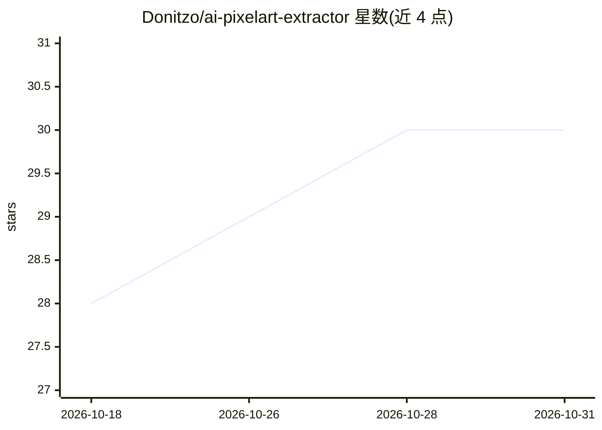

# Donitzo/ai-pixelart-extractor

⭐ 30 · Python · MIT · 推送 2026-04-27 · [GitHub](https://github.com/Donitzo/ai-pixelart-extractor) · 个人维护

**从 AI 生成图像中提取像素画的 Python 工具**

命令行工具，读取 AI 生成或对齐不佳的图像，通过多种图像处理方法提取其中的像素画。支持虚拟像素尺寸最小到 2 像素，小于该值则无法正确检测。README 自述为进行中项目（Work-in-progress），提取器对严重锯齿或错位的图像常会失败。以 Python 脚本形式运行，另有第三方提供的在线演示版本。示例展示了从 DALL-E 3 生成图像中提取的网格、花朵与飞船图案。

## 筛选速览

| 维度 | 判定 | 备注 |
|---|---|---|
| AI 角色 | `ai-native` | 本体是模型或模型工具 |
| 许可风险 | `permissive` | MIT |
| 部署形态 | `None` |  |
| 模型依赖 | — | README 未给出锁定关系 |
| 硬件要求 | — | 无带数字的原话,不猜 |
| 安装摩擦 | `low` | 无编译、无系统依赖或容器化 |
| 成熟度 | `idea` | |

## 能力要点

- 从 AI 生成或对齐不佳的图像提取像素画
- 支持虚拟像素尺寸最小 2 像素
- 提供 CLI 使用方式，可生成提取摘要图

## 适用场景

- 从 DALL-E 等生成图像中还原像素画素材
- 批量处理目录下的图像并生成提取摘要

## 场景标签

`图像视频处理` · 领域:感知与多模态

## 证据(README 行号)

> L7: A Work-in-progress. This pixel-art extractor uses various sophisticated image processing methods to try its best to 
> L17: The following are the three summary plots produced during extraction of art generated by DALL-E 3 (except for the g

## 星数曲线

2026-10-18 28 → 2026-10-31 30（+2）

---
*卡片 v1 · prompt 1.4 · 生成 2026-10-26 · 置信度 high · 依据 README sha `7b95e25e4d46` · [字段定义](../../DATASET.md)*
