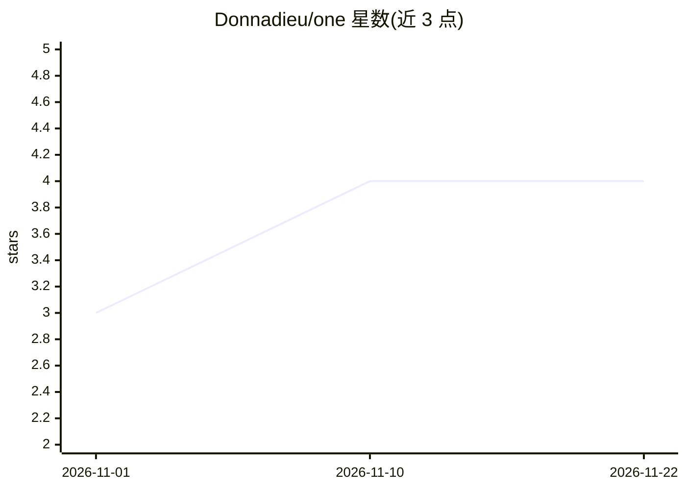

# Donnadieu/one

⭐ 4 · Swift · MIT · 推送 2026-11-21 · [GitHub](https://github.com/Donnadieu/one) · [官网](https://donnadieu.github.io/one) · 个人维护

**给非技术用户的 Mac 本地个人 AI 助手，一键安装语音引导**

面向从未用过终端的 Mac 用户的个人 AI 助手桌面应用：一键下载、语音引导完成设置，自动安装私有 Hermes Agent 引擎，用户用已付费账号（ChatGPT/Claude/Grok/OpenRouter）登录即可使用。助手可操作文件、浏览器、邮件、日历、密码库（KeePass），重要操作前必须人工确认；记忆以本地 Markdown 文件分房间保存；语音由本地 Kokoro 模型朗读。限制：仅支持 Apple Silicon、macOS 14+，当前为早期测试版，新闻与手机连接等部分功能未完成。

## 筛选速览

| 维度 | 判定 | 备注 |
|---|---|---|
| AI 角色 | `ai-native` | 本体是模型或模型工具 |
| 许可风险 | `permissive` | MIT |
| 部署形态 | `desktop` | 安装包/桌面程序 |
| 模型依赖 | — | README 未给出锁定关系 |
| 硬件要求 | — | 无带数字的原话,不猜 |
| 安装摩擦 | `medium` | 含编译或系统依赖之一 |
| 成熟度 | `idea` | |

## 能力要点

- 一键安装并语音引导设置，自动装私有 Hermes Agent 引擎
- 支持 ChatGPT/Claude/Grok/OpenRouter 登录，可随时切换
- 本地 Kokoro 语音合成，朗读回复与设置引导
- macOS sandbox-exec 沙箱限制引擎可访问路径

## 适用场景

- 非技术用户在 Mac 上使用个人 AI 助手
- 让助手代为整理文件、浏览网页、处理邮件
- 用已付费的 AI 订阅驱动本地助手而无需终端操作

## 场景标签

`AI 助手` · 领域:对话与助手

## 证据(README 行号)

> L3: **A personal AI assistant that lives on your Mac, for people who have never opened a terminal.**
> L7: You download it, you open it, and it talks you through the rest. It sets itself up, asks which AI you already pay fo
> L27: - **Bring the AI you already pay for.** ChatGPT, Claude, Grok or OpenRouter. Switch any time. Nobody locks you to o

## 星数曲线

2026-11-01 3 → 2026-11-22 4（+1）

---
*卡片 v1 · prompt 1.4 · 生成 2026-11-21 · 置信度 high · 依据 README sha `1d4670b039d0` · [字段定义](../../DATASET.md)*
