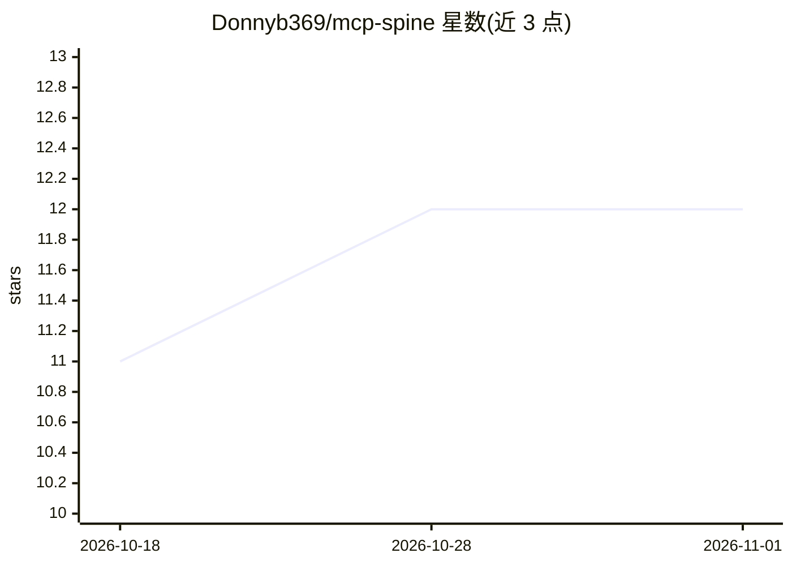

# Donnyb369/mcp-spine

⭐ 12 · Python · MIT · 推送 2026-04-25 · [GitHub](https://github.com/Donnyb369/mcp-spine) · 个人维护

**本地优先的 MCP 中间件代理：MCP 客户端与工具服务器间的安全与令牌管控**

以 Python 包形式提供的 MCP 代理层，部署在 Claude Desktop 等 MCP 客户端与多个 MCP 服务器之间，通过单一配置与入口管理工具流量。功能包括：JSON-RPC 校验与密钥擦除等安全代理、基于本地嵌入模型（all-MiniLM-L6-v2）与 ChromaDB 的语义路由、四级 schema 压缩（Level 2 标称 61% 令牌节省）、SHA-256 文件状态防护、日令牌预算、人工确认（HITL）、提示注入检测、插件钩子、HMAC 审计、Web 仪表盘与 webhook 告警。支持 stdio/SSE/Streamable HTTP 三种传输，对 Windows 有专项适配；语义路由为 pip 可选安装项 [ml]。

## 筛选速览

| 维度 | 判定 | 备注 |
|---|---|---|
| AI 角色 | `ai-ecosystem` | LLM/agent 周边工具 |
| 许可风险 | `permissive` | MIT |
| 部署形态 | `library` | 以包/库形式分发 |
| 模型依赖 | — | README 未给出锁定关系 |
| 硬件要求 | — | 无带数字的原话,不猜 |
| 安装摩擦 | `low` | 无编译、无系统依赖或容器化 |
| 成熟度 | — | 结构信号不足 |

## 能力要点

- 语义路由：本地嵌入模型只把相关工具发给 LLM，无 API 调用
- 四级 schema 压缩，Level 2 标称 61% 令牌节省
- HITL 确认、提示注入检测与 HMAC 审计日志
- 支持 stdio/SSE/Streamable HTTP 三种传输与插件钩子

## 适用场景

- 统一管理 Claude Desktop 连接的多个 MCP 服务器，收敛为单一入口
- 对工具调用做限速、密钥擦除与提示注入防护
- 控制每日与每服务器令牌消耗预算
- 为破坏性工具调用加人工审批环节

## 场景标签

`网络安全` · 领域:学习与行业

## 证据(README 行号)

> L6: **The middleware layer MCP is missing.** Security, routing, token control, and compliance — between your LLM and you
> L8: MCP Spine is a local-first proxy that sits between Claude Desktop (or any MCP client) and your MCP servers. One conf
> L20: |**Security Proxy**|Rate limiting, secret scrubbing, path jails, HMAC audit trail|

## 星数曲线

2026-10-18 11 → 2026-11-01 12（+1）

---
*卡片 v1 · prompt 1.4 · 生成 2026-11-01 · 置信度 high · 依据 README sha `c8db7d9ff75b` · [字段定义](../../DATASET.md)*
