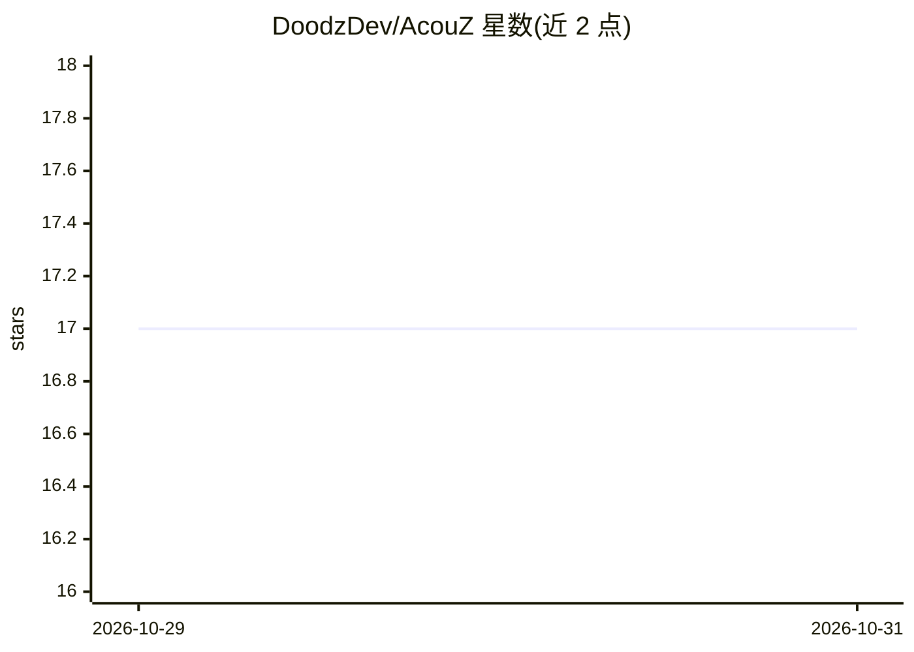

# DoodzDev/AcouZ

⭐ 17 · Python · MIT · 推送 2026-10-27 · [GitHub](https://github.com/DoodzDev/AcouZ) · [官网](https://doodzprog.github.io/AcouZ/) · 个人维护

**Windows 语音听写工具：按住热键说话，文字即刻上屏**

面向 Windows 10/11 用户的开源语音听写应用：按住/切换自定义热键录音，经 Groq Whisper 转录、可选由 Groq Llama-3 做标点与格式清理，通过剪贴板粘贴到光标处。支持选中文字后口述指令的上下文改写、多语言听写（EN/FR/ES/DE/IT）、英法双语界面、悬浮 VU 表与系统托盘。除 Groq API 调用外本地运行，需免费 Groq API key；全局键盘钩子需管理员权限。Python 3.11+ 编写（PySide6），可从源码运行或用 PyInstaller/Inno Setup 打包安装程序。

## 筛选速览

| 维度 | 判定 | 备注 |
|---|---|---|
| AI 角色 | `ai-native` | 本体是模型或模型工具 |
| 许可风险 | `permissive` | MIT |
| 部署形态 | `desktop` | 安装包/桌面程序 |
| 模型依赖 | locked-api |  |
| 硬件要求 | — | 无带数字的原话,不猜 |
| 安装摩擦 | `low` | 无编译、无系统依赖或容器化 |
| 成熟度 | — | 结构信号不足 |

## 能力要点

- 热键驱动听写：Whisper 转录 + Llama-3 后处理，亚秒级上屏
- 上下文感知指令：选中文字后口述，LLM 以选区为上下文改写/回复
- 多语言听写（EN/FR/ES/DE/IT）与英/法双语界面
- 除 Groq API 外全部本地运行，无需订阅

## 适用场景

- 在任意应用中按热键口述，自动转成带标点的文字
- 选中邮件或聊天文字后口述指令，让 AI 代为改写或回复
- 不订阅商业听写服务，用自己的免费 Groq key 做听写

## 场景标签

`语音识别` · 领域:感知与多模态

## 证据(README 行号)

> L12: AcouZ is a lightweight, privacy-friendly dictation assistant that runs entirely on your machine (except for the Gro
> L32: - **Context-aware instructions** — select text first, then dictate a command; the LLM responds using your selection

## 星数曲线

2026-10-29 17 → 2026-10-31 17（+0）

---
*卡片 v1 · prompt 1.4 · 生成 2026-10-30 · 置信度 mid · 依据 README sha `f6b4e675b1fc` · [字段定义](../../DATASET.md)*
