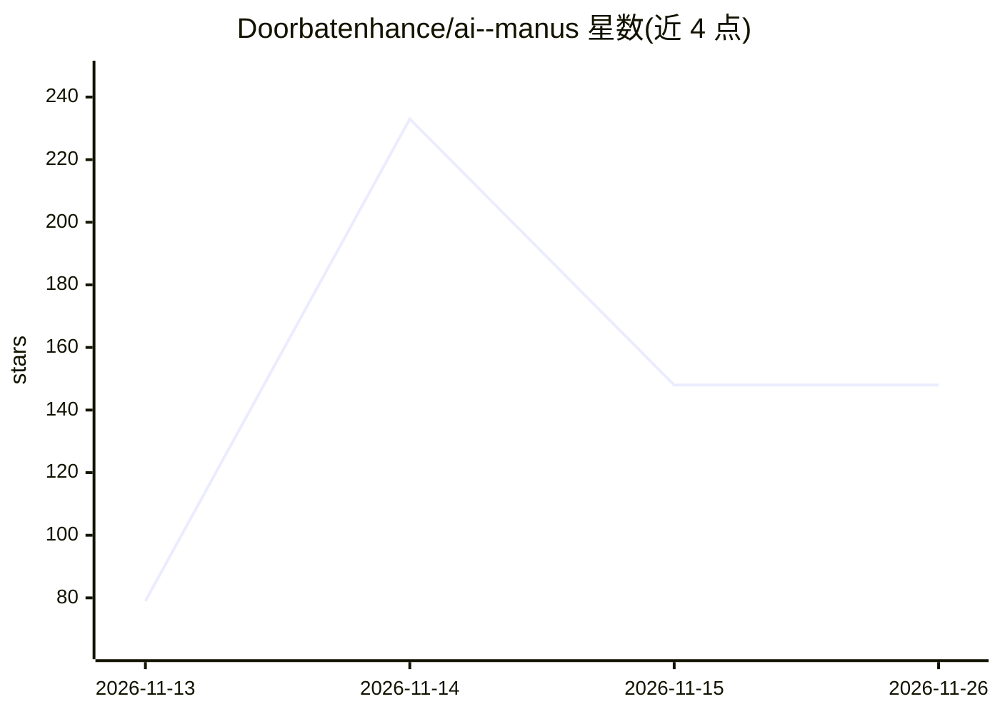

# Doorbatenhance/ai--manus

⭐ 148 · Apache-2.0 · 推送 2026-11-15 · [GitHub](https://github.com/Doorbatenhance/ai--manus) · 个人维护

**面向个人用户的自主 AI Agent，代为执行代码与浏览器操作**

README 描述的自主 AI 代理：用户以自然语言下达指令，代理自行编写并执行脚本、控制浏览器（导航、填表、采集信息），并可在多步任务中串联代码与浏览器操作，最小监督下完成日常事务。定位为家庭、学习与轻量办公场景的助手，非企业平台。README 提供硬件兼容表（最低 4GB 内存、双核 CPU）与使用流程说明，但未给出任何安装命令、源码结构或技术实现细节，页面顶部含下载链接与促销代码 PROMO2026。

## 筛选速览

| 维度 | 判定 | 备注 |
|---|---|---|
| AI 角色 | `ai-native` | 本体是模型或模型工具 |
| 许可风险 | `permissive` | Apache-2.0 |
| 部署形态 | `None` |  |
| 模型依赖 | — | README 未给出锁定关系 |
| 硬件要求 | — | 无带数字的原话,不猜 |
| 安装摩擦 | `low` | 无编译、无系统依赖或容器化 |
| 成熟度 | — | 结构信号不足 |

## 能力要点

- 自主执行代码：代理自行编写并运行脚本完成任务
- 浏览器控制：导航网页、填写表单、采集信息
- 代码与浏览器操作可在同一多步任务流中衔接
- 跨会话记忆工作流模式，重复任务无需重新说明

## 适用场景

- 让学生整理研究笔记、运行小型计算脚本
- 让代理代替自己浏览多个网页收集信息并汇总
- 自动处理填表、文件整理等重复性日常事务

## 场景标签

`编码 Agent` `浏览器自动化` `AI 助手` · 领域:效率与自动化

## 证据(README 行号)

> L10: - **Autonomous Code Execution:** Manus AI agent runs code on its own to complete tasks, so you can focus on decisio
> L18: Manus is an autonomous AI agent designed to run code and control a browser on your behalf. Instead of acting like a
> L22: Manus is not a heavy studio suite or a complex enterprise platform. It is a focused helper built for home, study, a

## 星数曲线

2026-11-13 79 → 2026-11-26 148（+69）

---
*卡片 v1 · prompt 1.4 · 生成 2026-11-17 · 置信度 mid · 依据 README sha `0f78ee3a5dd2` · [字段定义](../../DATASET.md)*
