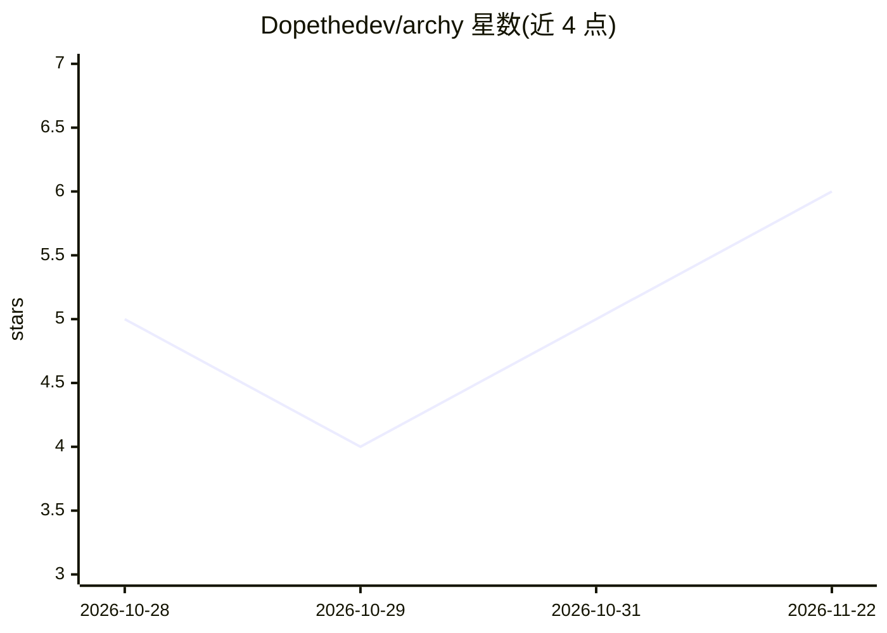

# Dopethedev/archy

⭐ 6 · Python · MIT · 推送 2026-11-03 · [GitHub](https://github.com/Dopethedev/archy) · 个人维护

**本机运行的语音助手：本地语音进出，离线也能应答**

运行在用户自己机器上的语音助手：silero 做语音活动检测，faster-whisper 做语音转文字，kokoro 做语音合成，思考部分经本地 `pi` 进程指向任意模型。功能包括唤醒词语音循环、打断、屏幕视觉问答、安全扫描、本地简报与提醒、持久记忆，以及一个随语音变换主题的仪表盘。面向关注隐私、希望语音链路尽量不出本机的用户。安装需 Python 3.12 与 `pi`，通过 git clone 加 uv 运行；Windows 安全扫描不可用，部分功能依赖可选系统工具。

## 筛选速览

| 维度 | 判定 | 备注 |
|---|---|---|
| AI 角色 | `ai-native` | 本体是模型或模型工具 |
| 许可风险 | `permissive` | MIT |
| 部署形态 | `desktop` | 安装包/桌面程序 |
| 模型依赖 | — | README 未给出锁定关系 |
| 硬件要求 | — | 无带数字的原话,不猜 |
| 安装摩擦 | `medium` | 含编译或系统依赖之一 |
| 成熟度 | — | 结构信号不足 |

## 能力要点

- 本地语音链路：silero VAD + faster-whisper 语音识别 + kokoro 语音合成
- 语音唤醒循环与打断，唤醒词可自定义且可携带请求
- 屏幕视觉问答与本机安全扫描（进程、SSH、浏览器扩展等）
- 语音控制的主题切换仪表盘

## 适用场景

- 不想把音频上传云端、在本机完成语音问答
- 用语音提问屏幕内容并让助手读取本机状态
- 需要提醒、定时与简报的个人语音助理
- 通过语音切换助手界面主题

## 场景标签

`语音 Agent` · 领域:对话与助手

## 证据(README 行号)

> L1: archy: a voice assistant that runs on your own machine
> L10: Everything that hears and speaks is local: silero for voice activity,
> L11: faster-whisper for speech to text, kokoro for speech out. Only the thinking goes

## 星数曲线

2026-10-28 5 → 2026-11-22 6（+1）

---
*卡片 v1 · prompt 1.4 · 生成 2026-11-21 · 置信度 mid · 依据 README sha `91a9bda1f091` · [字段定义](../../DATASET.md)*
