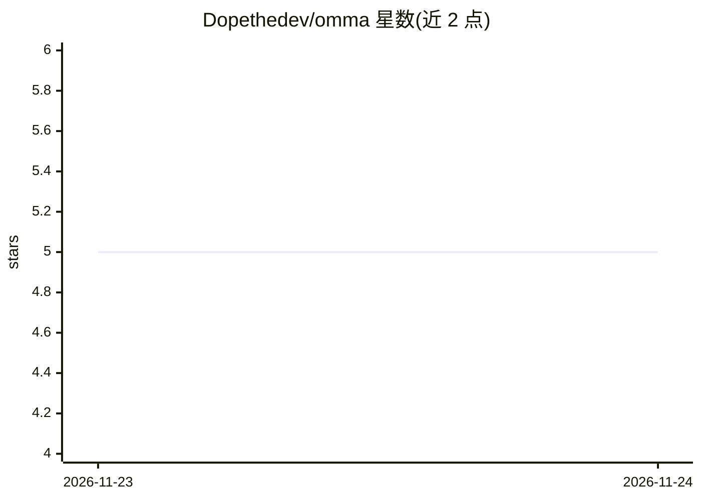

# Dopethedev/omma

⭐ 5 · Rust · Apache-2.0 · 推送 2026-11-17 · [GitHub](https://github.com/Dopethedev/omma) · 个人维护

**给纯文本 AI agent 提供图像感知的 CLI 与 MCP 工具**

一个 Rust 编写的图像感知工具：单一分析引擎同时提供 CLI 与 MCP server 两个前端。功能覆盖 Tesseract OCR（词级边界框、置信度、阅读顺序）、图像元数据、量化的调色板、64×36 空间颜色网格、基于边界框的布局区域，以及可选的 vision 问答（向 OpenAI 兼容端点发送单条问题，描述标记为 untrusted）。除 vision 调用外全部可离线运行；JSON 输出带版本化 schema，缺失子系统输出 null 并附 warning。安装需 Rust 1.89+ 从源码构建，或使用 CI 发布的预编译二进制（Linux 版需 glibc 2.39+）。

## 筛选速览

| 维度 | 判定 | 备注 |
|---|---|---|
| AI 角色 | `ai-ecosystem` | LLM/agent 周边工具 |
| 许可风险 | `permissive` | Apache-2.0 |
| 部署形态 | `library` | 以包/库形式分发 |
| 模型依赖 | local-ok | 支持本地模型 |
| 硬件要求 | — | 无带数字的原话,不猜 |
| 安装摩擦 | `medium` | 含编译或系统依赖之一 |
| 成熟度 | — | 结构信号不足 |

## 能力要点

- OCR/颜色/布局/元数据的确定性测量输出，缺失时返回 null 而非编造
- MCP server 暴露 analyze_image 与 omma_capabilities 两个工具
- 可选 vision 端点：本地 Ollama/llama.cpp/LM Studio/vLLM 或托管 GLM-5.3-Flash
- OCR 与 vision 内容均标记 untrusted，置信度低于 40 时输出警告

## 适用场景

- 让只支持文本的模型理解截图中的错误对话框内容
- 为 AI agent 的 MCP 客户端接入图像分析工具
- 离线服务器上批量提取图片中的文字与布局信息

## 场景标签

`OCR` · 领域:感知与多模态

## 证据(README 行号)

> L7: **Give a text-only model eyes.** `omma` turns an image into structured text and JSON
> L45: An image-perception utility: one shared analysis engine behind a CLI and a
> L145: |`omma mcp serve`|MCP server over stdio|

## 星数曲线

2026-11-23 5 → 2026-11-24 5（+0）

---
*卡片 v1 · prompt 1.4 · 生成 2026-11-23 · 置信度 high · 依据 README sha `7b1ff31a899b` · [字段定义](../../DATASET.md)*
