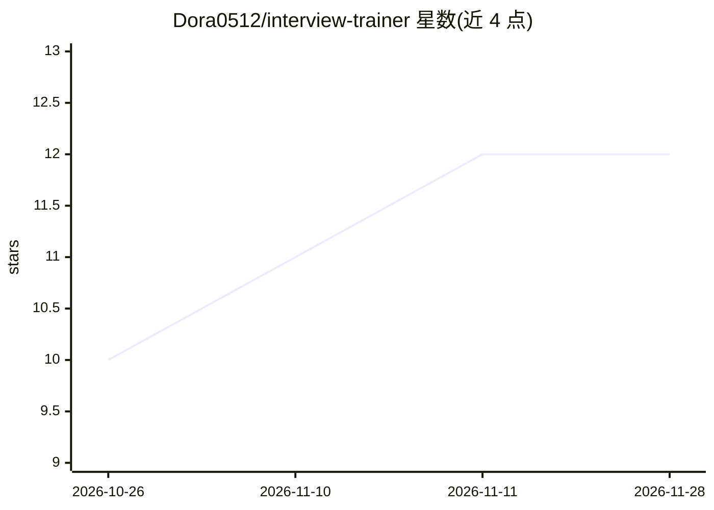

# Dora0512/interview-trainer

⭐ 12 · TypeScript · MIT · 推送 2026-10-29 · [GitHub](https://github.com/Dora0512/interview-trainer) · 个人维护 · 中文 README

**面向技术求职者的 Claude Code 面试训练插件**

以 Claude Code 插件形式分发的面试训练系统：通过一个 /interview 命令路由 9 个 skill，覆盖模拟面试（面试官角色扮演、逐题深挖、面试后评分）、真实面试复盘、L1→L5 渐进式技能闯关、自动更新的能力画像、公司管线追踪与按 JD 定制简历。跨会话维护掌握度档案，低分自动转为补强，超过 30 天的达标话题标记复测；另附本地 Next.js 看板应用与基于 Claude API 的浏览器端练习室。安装依赖 Claude Code 本体；个人面试数据存于本地工作区，不入公开仓库。

## 筛选速览

| 维度 | 判定 | 备注 |
|---|---|---|
| AI 角色 | `ai-native` | 本体是模型或模型工具 |
| 许可风险 | `permissive` | MIT |
| 部署形态 | `library` | 以包/库形式分发 |
| 模型依赖 | — | README 未给出锁定关系 |
| 硬件要求 | — | 无带数字的原话,不猜 |
| 安装摩擦 | `low` | 无编译、无系统依赖或容器化 |
| 成熟度 | — | 结构信号不足 |

## 能力要点

- 模拟面试引擎：Claude 扮演面试官，一次一题自适应深挖，结束后评分
- L1→L5 渐进闯关与跨会话掌握度档案，低分自动倒灌为补强
- 校准引擎：追踪自评 vs 教练评分、模拟分 vs 真实结果两条漂移
- 本地 Next.js 看板与基于 Claude API 的浏览器练习室

## 适用场景

- 求职季反复进行模拟面试并追踪能力提升
- 每轮真实面试后做结构化复盘并生成补强计划
- 按目标公司 JD 定制简历并管理投递漏斗

## 场景标签

`聊天机器人` · 领域:对话与助手

## 证据(README 行号)

> L7: > 一套技术岗 **面试训练官**（Claude Code 插件）。一个 `/interview` 命令打通模拟面试、面试复盘、
> L20: - **Mock interview engine** — Claude role-plays a hiring-bar interviewer, asks **one question at a
> L137: - **模拟面试引擎** —— Claude 扮演卡线面试官，**一次只问一个问题**，自适应深挖，面试中绝不透露答案，结束后评分。

## 星数曲线

2026-10-26 10 → 2026-11-28 12（+2）

---
*卡片 v1 · prompt 1.4 · 生成 2026-11-18 · 置信度 high · 依据 README sha `86ac69dae1bd` · [字段定义](../../DATASET.md)*
