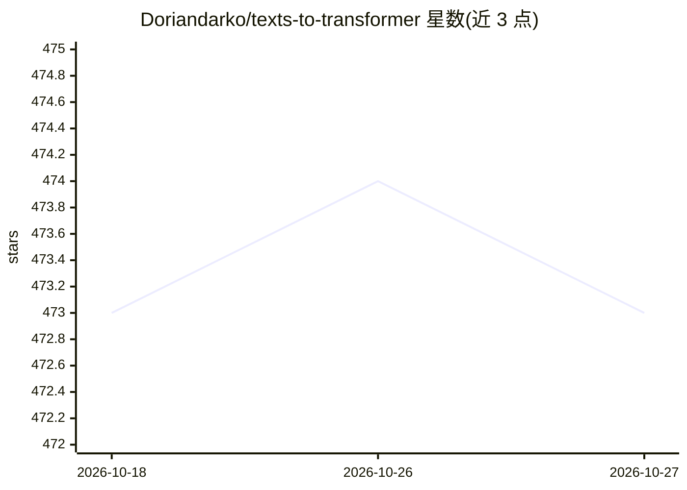

# Doriandarko/texts-to-transformer

⭐ 473 · Python · MIT · 推送 2026-07-08 · [GitHub](https://github.com/Doriandarko/texts-to-transformer) · 个人维护

**在 Mac 上用 iMessage 记录从零训练个人风格小 Transformer**

面向 Apple Silicon Mac 用户（M1+、macOS 14+）的端到端训练流水线：以只读方式快照 Messages 数据库，抽取文本并做 HMAC 假名化与标识符擦除，构建带七日隔离带的 90/5/5 数据切分，从零训练 4,096 词表的字节级 BPE 分词器与 1.38M/6.16M 参数的 decoder-only Transformer（MLX 0.32.0），经评估、导出后在本地终端生成回复建议。明确声明产物是个人风格模型而非通用助手，模型可能记住私密文本且须保持私有；不发送任何消息。

## 筛选速览

| 维度 | 判定 | 备注 |
|---|---|---|
| AI 角色 | `ai-native` | 本体是模型或模型工具 |
| 许可风险 | `permissive` | MIT |
| 部署形态 | `None` |  |
| 模型依赖 | — | README 未给出锁定关系 |
| 硬件要求 | — | 无带数字的原话,不猜 |
| 安装摩擦 | `low` | 无编译、无系统依赖或容器化 |
| 成熟度 | — | 结构信号不足 |

## 能力要点

- SQLite 只读快照 + HMAC 假名化与 URL/邮箱/电话擦除的隐私流程
- 从零训练 tokenizer 与 decoder-only Transformer（MLX，不用 PyTorch）
- 抗泄漏切分（七日隔离带）与跨切分重复会话校验
- 本地终端 chat 生成回复建议，附带记忆化审计与 Gate A-D 完成审计

## 适用场景

- 我想用自己多年的 iMessage 记录训练一个学我说话风格的本地小模型
- 在本机全程离线完成数据脱敏、训练、评估与导出
- 学习从零构建完整 LLM 训练流水线而非微调预训练模型

## 场景标签

`模型训练` · 领域:训练与推理

## 证据(README 行号)

> L3: Train a tiny language model from scratch on your iMessage history, entirely on your Mac.
> L19: The default small preset is a 4-layer, 1.38M-parameter decoder-only Transformer with a custom
> L30: An example development run used roughly 8M training tokens and produced a 1.38M-parameter model

## 星数曲线

2026-10-18 473 → 2026-10-27 473（+0）

---
*卡片 v1 · prompt 1.4 · 生成 2026-10-21 · 置信度 high · 依据 README sha `78a15efe0ba4` · [字段定义](../../DATASET.md)*
