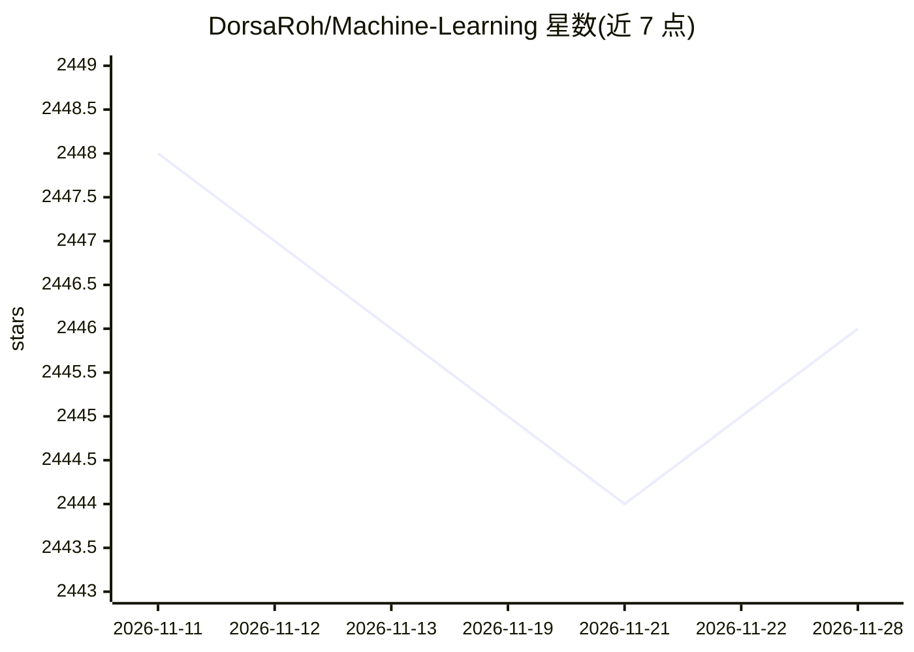

# DorsaRoh/Machine-Learning

⭐ 2,446 · Jupyter Notebook · MIT · 推送 2026-11-10 · [GitHub](https://github.com/DorsaRoh/Machine-Learning) · 个人维护

**仅用 numpy 从零实现神经网络与 Transformer 的教学仓库**

以教学为目的的机器学习从零实现仓库，内容分三部分：神经网络、Transformer、分布式模型。README 以图文讲解神经网络结构（神经元/层/权重/偏置/激活函数）、前向传播、损失函数、梯度下降与反向传播，并附 Neuron/Layer/NeuralNetwork 三个类的 Python 实现结构说明；Transformer 部分讲解 token、嵌入、位置编码、unembedding、softmax、温度与注意力机制，并指向 embedding_notes.ipynb。全部实现仅依赖 numpy，另提供 4 分钟视频版讲解。

## 筛选速览

| 维度 | 判定 | 备注 |
|---|---|---|
| AI 角色 | `ai-knowledge` | 知识聚合/清单类 |
| 许可风险 | `permissive` | MIT |
| 部署形态 | `None` |  |
| 模型依赖 | — | README 未给出锁定关系 |
| 硬件要求 | — | 无带数字的原话,不猜 |
| 安装摩擦 | `low` | 无编译、无系统依赖或容器化 |
| 成熟度 | — | 结构信号不足 |

## 能力要点

- 仅用 numpy 从零实现前馈神经网络（含前向/反向传播与训练循环）
- Transformer 原理讲解覆盖 embedding、位置编码、softmax、温度与注意力
- 提供 embedding_notes.ipynb 笔记本与配套视频

## 适用场景

- 学习神经网络与 Transformer 的底层原理与手写实现
- 查阅激活函数、反向传播、注意力等概念的推导笔记
- 作为从零实现 ML 的代码参考

## 场景标签

`教程课程` · 领域:学习与行业

## 证据(README 行号)

> L1: # Machine Learning from Scratch
> L2: Implementations of ML, using only numpy.
> L192: Here's a basic implementation of a neural network (feed-forward, multilayer percepton) from scratch in Python:

## 星数曲线

2026-11-11 2,448 → 2026-11-28 2,446（-2）

---
*卡片 v1 · prompt 1.4 · 生成 2026-11-17 · 置信度 mid · 依据 README sha `1dc3e94f9943` · [字段定义](../../DATASET.md)*
